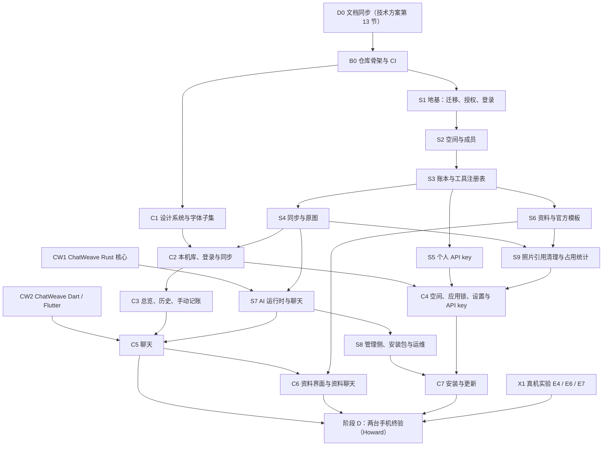

# 家簿 · 实施计划

> 版本 v0.2（2026-10-27）。v0.2 按 Codex 评审修订：理清 C5 / C6 与资料聊天、字体字表、默认空间的依赖，补日志与崩溃、照片真机验证、评测的通过标准，负对照只用在关键规则上。对应需求 v0.19、技术方案 v0.3、决策清单 P1–P64。
> 本文回答“**按什么顺序做、每一步做到什么程度算完**”：把[技术方案](technical-design.md)切成可以一片一片交给 Codex（AI 编程代理）实现的**切片**，写明依赖、范围、首版最低交付标准和验收测试。它同时回答[待定问题 37](../decisions/README.md#待定问题open-questions)（首版每项能力的最低交付标准与先后顺序）。
> 本文不重抄技术方案；每个切片只写“做什么、做到哪、怎么验”，“怎么做”以技术方案的章节为准（下称“技术方案 x.y”）。

## 0. 怎么读、怎么用

- **切片**：一段能独立合并、独立测试的工作，通常对应一个或几个 PR（拉取请求，一次代码合并申请）。每个切片都是“竖切”的：从数据库到接口（或从本机库到界面）一次做通，做完就能用测试证明它工作。
- 切片编号：`B` 仓库骨架，`D` 文档，`CW` ChatWeave 库（独立仓库），`S` 服务端，`C` 客户端，`X` 真机实验。依赖写在每个切片的“依赖”里，没写的就可以并行。
- **首版最低交付**：这项能力在首版里至少要做到的程度。做到了就算完，不往上加；需求里没有的不做。第 2 节是按能力汇总的总表，第 3–5 节在每个切片里展开。
- 流程照 P33：Codex 写代码 → luna.coco 评审与测试（第 7 节）→ 阶段 D 由 Howard 在两台手机上验收（第 6 节）。中途不设额外的人工关卡；有分歧或需要产品决定时才找 Howard。

## 1. 顺序总览

三条线可以同时推进：**服务端**（S1→S8）、**ChatWeave**（CW1、CW2，在 ChatWeave 仓库）、**客户端**（C1 先做，C2 起接服务端）。关键路径是 S1→S4→S7→C5→C6：聊天是首页，又依赖最多的东西；资料的聊天流程（需求第 5 节第 2 条）要等资料工具和资料卡，所以放在 C6。

和需求第 10 节四个阶段的对应：

| 需求阶段 | 在本文里 |
|---|---|
| A 可行性 | 技术方案第 14 节 E1–E5 已经做完；S1 落地后在真实迁移上补跑隔离矩阵（技术方案 14 节开头的说明） |
| B 本地交互骨架 | C1–C3，加上 C5 的界面部分：C5 的聊天界面在 S7 之前就用 ChatWeave 的脚本化假流和夹具开发（客户端第 8 节第一批切片的第 3 条），所以聊天的手感不用等服务端；C3、C5 做完时各出一个测试版安装包给 Howard 试手感，**不是关卡**，意见进后续切片 |
| C 服务端与 AI 闭环 | S1–S8 |
| D 两台手机终验 | 第 6 节 |

## 2. 首版最低交付标准（待定问题 37）

范围不再重开（P1、P31、P35、P36、P43–P48）。下表每一行是“首版至少做到这样”；没列的细节以需求和技术方案为准，不另加功能。

| 能力 | 首版最低交付 | 切片 |
|---|---|---|
| 账号与登录 | 管理命令建账号；用户名密码登录、会话存在安全存储、改密码（登出其他会话）、管理员重置后的提示（P49）、停用账号即时生效；登录限流 | S1、C2 |
| 空间 | 默认个人空间自动创建；新建（选币种、时区、点缀色）、改名改色、切换（打开上次的空间）、删除（输入空间名，默认空间不可删）；非成员一律 404 | S2、C4 |
| 成员 | 所有者按用户名邀请、对方接受 / 拒绝、所有者撤回（P71）；移除、退出（有未上传内容时先提示）、转让所有者；邀请人离开后未接受的邀请仍有效（P71 取代 P64③）；重新加入复用成员行 | S2、C4 |
| 账户 | 真实账户、用途账户（含备用金）的新建、改名、归档（余额须先转走）；起始余额；每月拨入计划（P55 的全部时间规则） | S3、C3 |
| 记录 | 服务端与工具支持支出、收入、转账、调拨、退款五种记录 + 计划产生的拨入（AI 与 key 都能用全部种类）；编辑、撤销、恢复；退款不变量（S39）与 P64 的撤销规则；标签（预置 + 自建）；余额按记录推导 | S3、C3 |
| 冲突 | 只对“修改”出现；两个版本二选一；撤销优先的两个按钮（P56）；冲突解决前余额按服务器版本 | S4、C3 |
| 离线 | 所有空间内容写入先进本机库和 outbox（待发送队列）；联网后按技术方案 5.2 的规则上传；失败项保留可重试，不静默丢失 | S4、C2 |
| 总览 / 历史 | 总览：两类账户余额、近期变化、待处理的离线项、资料摘要；历史：按成员、账户、标签、类型、时间筛选，进详情看原图、变更记录、编辑 / 撤销 | C3、C6 |
| 手动记一笔 | 小表单（P54）：顶部切换支出 / 收入 / 转账 / 调拨，默认支出，字段随种类变（转账、调拨是转出方与转入方）；退款从支出的详情页“退款”进入（**待 Howard 确认，见第 9 节**）；平时可用；AI 不可用时聊天页给出入口；排队中的消息可“改为手动填写” | C3、C5 |
| 聊天 | 文字流式、记录卡 / 指标 / 表格 / 趋势图 / 选项 / 确认 / 小表单七种块；过程条；暂停等回答（锁输入框 + “输入其他内容”）；停止；断线续传；“没有完成”与重试（P64）；首次设置在对话里完成 | S7、CW、C5 |
| 资料 | 四个官方模板（体检、视力、疫苗、证件，P35）+ 无模板的默认渲染；对象（家人、宠物、房屋、车辆、其他）与同名沿用（P58）；按对象的时间线、全家时间线、同一指标的前后对比；原图核对 | S6、C6 |
| 自定义模板 | 自建服务端把 `jiabu.template/1` 文件放进模板目录即生效；坏文件跳过并报错 | S6 |
| AI 接入 | SIWC 一个提供方能跑完整 Agent 循环（含图片）；“AI 暂时不可用”状态；付费备选的开关存在但默认关闭；每次模型调用计量 | S7、S8 |
| 个人 API key | 创建（名称、有效期、只读 / 读写）、只显示一次、列表含最近使用、改名、撤销；工具 API；“通过 API key”标注；限流；每账号 20 个上限 | S5、C4 |
| 管理侧 | `admin` 命令覆盖服务端 9.8 的全部子命令 + `release`；管理 API 与命令同一服务层；管理审计；看不到内容的三层保证 | S8 |
| 安装与更新 | 服务端每 6 小时拉 GitHub Releases、校验后提供；手动上传；App 启动和回前台检查、提示条、下载续传、校验、交给系统安装器；强制更新期间只读不丢数据 | S8、C7 |
| 多语言 | 简体中文和英文两份 ARB（界面文案文件），从 C1 起每个切片的新文案两种语言一起加；预置分类按个人语言显示 | C1 起 |
| 应用锁 | 生物识别或图案，PIN 兜底，回前台超时再验；通知不显示内容、多任务缩略图遮挡 | C4 |
| 备份与部署 | docker compose 与 systemd 两种部署；每日备份脚本与恢复说明 | S8 |
| 照片占用 | 编辑去掉的照片一天后清理、撤销的保留（P67）；按空间的照片占用：每日快照、管理 API 与 `admin storage summary`、App 空间设置显示本空间占用（P68）；只统计，不收费、不设上限 | S9、C4 |

**明确不做**：需求第 11 节全部；技术方案 7.8 列出的运行时简化（无子 Agent、无 `external` 工具）；跨空间移动（P63）。

## 3. 准备：文档与仓库

### D0 文档同步（luna.coco，先于 S1）

Codex 会读全部工程文档，旧说法留着就会写出两种实现，所以**动手写代码之前**先把技术方案第 13 节的 26 条改进对应文档。按目标文档归并：

| 文档 | 第 13 节的条目 |
|---|---|
| 服务端规范 | 1、2、3、4、5、6（5.1 的 `chat_entries`）、7（9.4 的任务类型）、9、11、12、13、14（表结构部分）、15、16、19、22、23、24、25、26；第 7 节测试清单里“跨空间移动”一项删除 |
| AI 层 | 7、8、14、19（14.4 A 第 1 步）、22；另把 E1 的结论写进 4.4 与 15.3：SIWC 的请求头 `session_id` = `prompt_cache_key` = 会话 ID，`prompt_cache_options` 与显式断点会被拒（400），不发；15.3 原来的“v1 不发任何缓存参数”作废 |
| 客户端规范 | 4（3.6）、10、17、18 |
| 决策清单 | 6（S13 的说明）、26（S14） |
| ChatWeave | 20、21 已同步（ChatWeave 9998524）；21 的一致性测试在 CW1 里做 |

- 改法：被取代的段落直接改成新结论，不保留旧文字（文档只记当前结论，见文档索引的约定）；每份文档版本号 +0.1。
- **完成标准**：按上表“条目 × 目标章节”逐条打勾（在技术方案第 13 节每条后面注明改了哪份文档哪一节）；另外 `grep` 技术方案第 13 节里出现的旧名字（`record_events`、`archived_at`、`parse_entry` 任务类型、`/cancel`、`setup.submit`、`move_to_space`、`moved_to_record_id`、“2–4 个 worker”等）在服务端、AI 层、客户端三份文档里只剩“已改为……”的说明或完全消失；改完技术方案第 13 节标“已同步”。

### B0 仓库骨架与 CI

- **依赖**：D0。
- **范围**：`server/`（Cargo workspace，按技术方案 2.2 建全部 crate 的空壳和依赖方向）、`client/`（pub workspace：`app/` + `packages/jiabu_design`，客户端第 8 节）、`.github/workflows/` 五个流水线（技术方案 2.1）、`server/AGENTS.md`、`client/AGENTS.md`（服务端 7.1、客户端 7.2）、`client/tool/build-host/` 的构建机安装脚本与 golden 镜像 Dockerfile（技术方案 10.8）。
- **最低交付**：
  - server-ci：fmt → clippy `-D warnings` → nextest（PostgreSQL 18 服务容器）→ cargo-deny / audit → 管理侧依赖检查（服务端第 2 节）→ “`crates/api` 不得出现 `SystemTx`”与“禁止会话级 `SET jiabu.` / `set_config(…, false)`”两条 grep 规则（技术方案 2.2、14 节 E2）→ OpenAPI 导出一致性。
  - client-ci：在固定 golden 镜像里跑 analyze、format、`check_rules`、测试、golden。
  - release-server / release-app 先建好空流程（只打包、不发布），S8 / C7 再补全。
  - ChatWeave 按固定提交作为路径或 git 依赖接入（技术方案 10.9），CW1 / CW2 没完成之前只依赖它的 schema 与夹具。
- **验收**：故意违反每一条 CI 规则（管理侧 crate 引用 `db`、`api` 里写 `SystemTx`、客户端违反 `check_rules`）各一次，CI 都失败；一个空白页 golden 在 CI 和构建机本地生成结果相同。

**早期原型的位置**：早期原型（单 crate、SQLx、记录 REST 接口、原生 Android 客户端）按 S2 决策不保留，不作为代码基础。实现时可以参考的只有两处小逻辑：登录防暴力破解（按 IP + 用户名限流、只信任来自本机反向代理的 `X-Real-IP`）和 Argon2 密码哈希参数；按新结构重写，不复制文件。

## 4. ChatWeave（在 ChatWeave 仓库）

ChatWeave 目前只有协议文档和 schema，没有代码。实现按它自己的 [MVP 计划](https://github.com/zz-howard/chatweave/blob/master/docs/mvp-plan.md)（T0–T11）做，本文只规定家簿需要的顺序和两处补充。

### CW1 Rust 核心（ChatWeave T0–T4）

- **依赖**：无（可与 B0 同时开始）。
- **范围**：T0 骨架与 CI、T1 协议 0.1 定稿与一致性夹具、T2 `chatweave-protocol`、T3 `chatweave-server`（生成器、`EventLog`、SSE）、T4 动作注册表与 dispatcher。
- **两处补充**（家簿技术方案第 13 节第 20、21 条，ChatWeave 文档已改）：
  1. **SSE 交接**按 ChatWeave `streaming.md` 4.1 的新顺序实现（先订阅、再读日志、按 `seq` 交接、缺号回日志补读、接收端落后就断开）。T3 的验收加一条**竞态一致性测试**：在“读完日志”与“开始消费广播”之间插入一次写入（含最后的 `message.end`），断言客户端收到完整、无重复的序列；再把实现改成“先读日志后订阅”，断言这条测试失败（负对照）。
  2. **dispatcher 顺序**按 `protocol.md` 5.2 的新顺序：宿主 `authorize` 在幂等回放之前。T4 的验收加一条：同一个动作 ID 第一次成功、之后 `authorize` 改为拒绝，第二次提交得到拒绝而不是回放。
- **完成标准**：MVP 计划 T0–T4 的验收全部通过 + 上面两条测试。S7 只依赖到这里。

### CW2 Dart / Flutter（ChatWeave T5–T9）

- **依赖**：CW1 的 T1（夹具）。T5 可与 T2–T4 并行。
- **范围**：T5 `chatweave_core`、T6 渲染底座、T7 默认组件、T8 列表与输入框、T9 动作客户端。
- **完成标准**：MVP 计划 T5–T9 的验收全部通过。C5 依赖到这里。

### 不阻塞家簿的部分

- T10（示例 App 与端到端测试）在家簿 C5 之后做，作为 ChatWeave 0.1.0 发布的前提之一；T11 就是家簿的 S7 + C5。
- 家簿集成中发现库缺的能力，一律以通用形式进库（G3），在 ChatWeave 仓库单独提 PR，家簿再升级固定提交（每次一个 PR，技术方案 10.9）。
- 0.1.0 发布：两端夹具全过且家簿阶段 D 通过之后（G10）。

## 5. 服务端与客户端切片

每个切片的测试都写成自动化测试，跟代码在同一个 PR 里。下面“验收”里提到“需求表：××”的，指需求第 10 节“规则 → 验收场景对照”表里对应的那一行，在这个切片里用自动化测试覆盖能在服务端或单机上测的部分，两台手机的部分留给阶段 D。

### S1 地基：迁移、授权、登录

- **依赖**：B0。
- **范围**：`server/migrations/0001_…sql` 起的首批迁移（技术方案第 3 节全部表、3.10 的角色与 RLS、`SECURITY DEFINER` 清理函数；AI 运行与管理侧的表也在首批里建好，服务端 5.1）；`sqlx::migrate!` 执行器（10.1）；从库生成 SeaORM 实体并在 CI 检查一致；`db` 的 `SpaceTx` / `SystemTx`（4.3）与 RLS 设置（4.4）；`tools::authorize()`（4.2）；`Principal`（4.1）；登录、登出、会话、改密码、`/me`、`/meta` 与 `X-Jiabu-Client` 版本握手（6.1）；错误模型（6.2）；**建账号时在同一事务里建好默认个人空间、本人成员行和预置分类**（服务端 3.1；`domain::presets` 也在这里建，7.6）；请求 ID 贯穿与 JSON 日志（服务端第 6 节）、`POST /client-logs`（客户端第 5 节）；`admin db init-roles | migrate`、`admin user create|reset-password|disable|enable`。
- **最低交付**：会话令牌只存 SHA-256；登录限流 5 次 / 分钟（IP + 用户名）；重置后首次登录返回 `admin_reset_at`；停用即删除全部会话。
- **验收**：
  - **隔离矩阵测试框架**（技术方案 11.1 第一行）：对每个带 `space_id` 的接口 × {非成员、已退出、别的空间的 ID、不存在的 ID} 断言响应逐字节相同；后续切片每加一个接口都必须登记进这张矩阵，没登记 CI 失败。
  - 在真实首批迁移上重跑 E2 的断言（没设置读不到写不进、事务级设置不残留、应用角色不能绕过 RLS）。
  - `jiabu_admin` 角色读内容表报权限错误（服务端第 7 节）。
  - 改了已执行过的迁移文件，启动被拒。
  - 建账号失败（例如用户名重复）时不留下半个默认空间；一条请求的 ID 出现在这条请求的每行服务端日志里，日志里没有密码、令牌、原话（日志快照测试）。

### S2 空间与成员

- **依赖**：S1。
- **范围**：技术方案 3.3、6.3 “空间”组的全部接口；新建空间时复用 S1 的初始化（成员行、预置分类）；邀请状态转换（S38）；删除空间与后台清理（3.10）；`join_epoch` 递增规则。
- **最低交付**：第 2 节“空间”“成员”两行。
- **验收**：需求表：转让与删除空间（P17、P18、P57）；邀请的接受 / 撤回并发只有一个生效；接受进已删除空间失败；邀请人退出后其待处理邀请变为 `cancelled`（P64）；最后一位所有者不能直接退出；默认空间没有删除 / 退出 / 邀请。

### S3 账本与工具注册表

- **依赖**：S2。
- **范围**：`tools` crate 的 `AgentTool` / `ToolRegistry` / `ToolCtx`（6.4）与账本类全部工具；余额推导（3.4）；每月拨入后台任务（3.4、10.4）；退款不变量（3.4，S39）与 P64 的撤销规则；`entity_events` 审计（3.6）；工具 API 路由由注册表生成（`GET /spaces/{id}/tools`、`POST /spaces/{id}/tools/{tool}`，服务端 4.3）；OpenAPI 导出与 `oneOf`（6.5）；`GET /status` 先返回固定的“AI 不可用”，S7 再接真实状态。
- **最低交付**：第 2 节“账户”“记录”两行。拨入时间规则必须用可注入的时钟测试，不依赖真实时间。
- **验收**：需求表：币种与退款（P53）、每月拨入时间（P55）；同一工具在“工具 API”与（S7 里的）Agent 循环两个入口的结果一致——S3 先用一个测试替身调用 `invoke()` 代表第二个入口；撤销有有效退款的支出返回 `has_refunds`；改支出金额低于已退金额被拒；`AgentOnly` 工具没有路由。

### S4 同步与原图

- **依赖**：S3。
- **范围**：`POST /sync/push`（5.3：批次、授权先于幂等回放、`join_epoch`、逐条结果）、`POST /sync/pull`（5.4：变更序号、分页、模块与会话归属过滤、墓碑）、冲突（5.5）、退出 / 被移出 / 重新加入（5.6）、原图上传下载与 `blob_refs`（3.7、5.8）、原图派生尺寸（`storage` crate）、幂等表与清理（3.11）。
- **最低交付**：第 2 节“冲突”“离线”两行的服务端部分。
- **验收**：需求表：修改冲突、撤销优先（P38、P56）与退出与重新加入（P13、P19、P52）的服务端部分；退出后、退出又加回后重放旧 `op_id` 拿不到当时的结果（11.1）；同一空间写入的变更序号顺序 = 提交顺序（并发写入测试）；两个空间传同一张图响应逐字节相同；同空间两位成员在聊天里发同一张图都能下载（S35）；拉取在分页边界不漏不重。

### S5 个人 API key

- **依赖**：S3（工具 API）。可与 S4 并行。
- **范围**：服务端 3.3 的 key 全部规则；`/me/api-keys` 接口；key 认证进 `Principal`；只读 / 读写 key 的工具过滤；限流；`api_key_audit` 与“通过 API key：名称”标注随同步下发；`admin user api-keys`。
- **最低交付**：第 2 节“个人 API key”一行的服务端部分。
- **验收**：服务端第 7 节“个人 API key”与“工具 API”两段的全部测试；需求表：API key 跟着成员身份走（P51）。

### S6 资料与官方模板

- **依赖**：S3。可与 S4、S5 并行。
- **范围**：技术方案 3.5（资料、对象、同名沿用）、第 8 节模板协议（解析、JSON Schema + 语义校验、比较口径、版本、热加载模板目录）、资料类工具（6.4）、`GET /templates`（带 `ETag`）；`server/templates/official/` 四个官方模板：体检（8.7 已有完整示例）、视力、疫苗、证件，各自带中英文标签和 AI 整理提示。
- **最低交付**：第 2 节“资料”“自定义模板”两行的服务端部分。
- **验收**：需求表：资料关联的更正（P44、P58）；四个官方模板都通过协议校验，并各有一份虚构样例资料的写入 → 读取往返测试；坏模板文件被跳过、服务正常启动、日志报错；不兼容的模板修改被拒（8.6）；`document_metric_series` 只比较同对象 + 同 `metric` + 同单位（8.5）。

### S7 AI 运行时与聊天

- **依赖**：S4（同步、原图）、CW1。资料类工具在 S6 合并后自动进入模型的工具清单。
- **范围**：
  - `ai` crate：`ModelProvider`、`AiRouter`（熔断、计费策略、付费备选开关默认关闭）、SIWC 适配器（按 E1 的结论：`session_id` 请求头 = `prompt_cache_key` = 会话 ID；`store: false` 时从 `response.output_item.done` 拼输出）、`MockProvider`；`ai_calls` 计量；`admin provider login chatgpt` 与提供方 / 模型 / 路由 / 价格的管理命令（S8 之前先有这几条，否则 S7 没法配置模型）。
  - `chat` crate：语义块映射（AI 层 13.2）、`x-jiabu.*` 块 Schema、`chat_stream_events` 事件日志、`RunEmitter`、`StreamHub` 与 SSE 交接（7.4）、消息存储。
  - `agent` crate：`RunService`、2 个 worker、`next_action()` / `render_request()`、journal、租约与清扫器、动作处理器（7.1–7.5，AI 层第 14 节）、重试（7.3，P64）、停止、`/chat/active-messages`。
  - 评测集：`eval/entries/` 先做 60 条（AI 层第 9 节），其中中英文含糊日期各 10 条（7.6）；只用自造数据。
- **最低交付**：第 2 节“聊天”“AI 接入”两行的服务端部分。
- **验收**：
  - AI 层 14.12 的故障注入测试与服务端第 7 节“聊天流与动作”“AI 运行”两段全部通过（用 `MockProvider`，不连真实模型）。
  - 需求表：追问可在任一台手机回答（P25–P27）、停止与重试（P27、P50）的服务端部分；“午饭 50，停车 10”在第二笔失败后重试只记停车（7.3 的例子写成测试）；排队中的 B 与暂停中的 A 的先后（7.3 最后一条）。
  - 适配器：wiremock 回放 + 请求体快照（AI 层第 9 节）；录制的 SIWC 交互先脱敏再入库。
  - 同一运行的同一份 journal 在“暂停前”和“重启后恢复”各渲染一次，前缀逐字节相同（AI 层 15.5 的离线测试，跨进程）；跨运行不要求整段相同（空间上下文、历史压缩可以合法变化，7.6、A19）。
  - 在线冒烟（手动，`--features live`）：用真实 SIWC 登录跑一遍文字记账、收据图片、追问三条，记下缓存命中情况（性能观察，不是门槛，AI 层 15.5）。
  - 评测集用真实模型跑一遍，**行为类样例是硬标准**：含糊日期（中英文各 10 条）必须追问、不得写入；需要确认的修改在确认前不得写入；信息不全的样例必须追问。金额、日期、分类的准确率先不设数字门槛，luna.coco 逐条看失败项，属于提示词或工具描述的问题就改了重跑，结果 CSV 入库。

### S8 管理侧、安装包与运维

- **依赖**：S7（AI 配置与用量的表和服务已在 S7 建好）。
- **范围**：`admin` 命令剩余子命令与 `release list|check|upload|withdraw`（服务端 9.8、技术方案第 13 节第 9 条）；管理 API `/admin/v1` 与 `openapi-admin.json` 字段快照（服务端 9.4、9.2）；管理审计；密钥加密（服务端 9.6）；安装包拉取任务与签名证书指纹预检（10.5）；`GET /app/releases/*`；`GET /meta` 的 worker / 备份状态（10.7）；`deploy/`（docker compose、systemd 单元、`backup.sh`、`restore.md`，10.2、10.6）；release-server 流水线补全（服务端 8.2）。
- **最低交付**：第 2 节“管理侧”“备份与部署”两行，“安装与更新”的服务端部分。
- **验收**：服务端第 7 节“管理 API”一段；用真实签过名的 APK 和“换了证书”的 APK 各做一个夹具，前者通过、后者 `rejected`；按 `restore.md` 在临时目录恢复一次备份并跑 `admin db check`；release-server 在 x86_64 与 arm64 原生 runner 上各出一个包。

### S9 照片引用清理与占用统计

- **依赖**：S4（`blob_refs` 与原图清理）、S6（资料里的 `image` 值）。可与 S7、S8 并行。单独成片而不并进 S8：它改的是 S3 / S6 的编辑工具和原图存储，和 S8 的管理 API、安装包、部署没有共同的代码，单独评审更清楚；放在 S6 之后，账和资料两种照片一次做完。
- **范围**：编辑去掉照片时删引用（技术方案 3.7“编辑时去掉照片”：`update_record`、`update_document`，撤销 / 作废不删）；`blobs.stored_bytes` 迁移、上传时写入、已有行的一次性补齐；`space_storage_daily` / `storage_daily_totals` 两张表、每日快照任务（10.4，原图清理之后）；`GET /spaces/{id}/storage`；`jiabu_admin` 对两张快照表的 `SELECT` 授权；管理 API `GET /storage` 与 `admin storage summary`（服务端 9.4、9.8；S8 之前先落在已有的管理命令与管理 API 骨架上，S8 补全其余部分）。
- **最低交付**：第 2 节“照片占用”一行的服务端部分。
- **验收**：需求表：照片的移除与占用（P67、P68）的服务端部分；去掉的照片在本空间别的账（含已撤销的）上还有时不删引用、只在本人聊天里还有时文件保留；撤销 / 恢复前后照片都能下载；两个空间各传同一张图时两边占用都包含它，一个空间删掉后另一个不变；快照同一天重跑覆盖不重复；`jiabu_admin` 读 `blobs` / `blob_refs` 仍被拒（9.2 的数据库层检查）。负对照：把占用查询改成跨空间去重，“跨空间各算各的”的测试应失败。

### C1 设计系统与字体子集

- **依赖**：B0。
- **范围**：`packages/jiabu_design`（客户端第 4 节、设计规范：令牌、字体、图标生成、倾角、纸面组件、组件目录页）；两份 ARB 的骨架；**字体子集字表**。
- **字体子集字表**（技术方案 9.5、14 节 E4）：`client/tool/fonts/subset.py` 的输入是一组“字的来源”文件，CI 检查来源里的每个字都在子集里，缺字失败。C1 先接两个来源：ARB 里的 `hand*` 文案、常用记账词表 `client/tool/fonts/common_words.txt`（luna.coco 起草，约 300 词：餐饮、交通、日用、早饭、打车、超市、房租、水电……）。之后两个来源由各自的切片接上：S1 把预置分类的中英文名与别名导出成 JSON 提交进仓库，S6 把四个官方模板的中英文标签导出成 JSON；接上时重新生成子集。这样 C1 不用等服务端。
- **最低交付**：组件目录页里每个组件都有 golden（浅色 × 360 / 430 宽 × 100% / 200% 字号，设计规范的验收清单）。
- **验收**：客户端 7.3 的 G1–G3；“数字 + 中文”混排的回退链 golden 与 E4 的结论一致。

### C2 本机库、登录与同步

- **依赖**：C1、S4。
- **范围**：drift 表与按“服务端 + 账号”分库（技术方案 9.1、9.2、5.7）；服务端地址设置与登录；dio 客户端与版本握手（9.6 的握手部分）；`SyncEngine`、`OutboxProcessor`（5.2 的“同一实体同一时间只有一条在途”）、`ConflictService`（5.5）；退出 / 被移出 / 中间退出过的本机清除（5.6）；后台同步（客户端 3.3）；`MediaService`（拍照选图、转 JPEG、去 GPS 等 EXIF、算 SHA-256，9.4）；本机滚动日志、异常捕获与下次启动上报（客户端第 5 节）。
- **最低交付**：第 2 节“账号与登录”“离线”两行的客户端部分。
- **验收**：用真实服务端（集成测试里起一个）跑：离线写入三条 → 联网 → 全部上传且顺序与依赖正确；同一记录离线改三次分三轮上传；冲突状态机的单元测试覆盖技术方案 5.5 的每个转换；`join_epoch` 变大时本机该空间被清除后完整重拉；切换服务端地址前提示未上传条数、旧分区保留。

### C3 总览、历史、手动记账

- **依赖**：C2（界面可以先用本机假数据开发，接同步后再改用真实数据）。
- **范围**：总览、历史 / 搜索、记录卡与记录详情（技术方案 9.3 的显示状态）、编辑 / 撤销 / 恢复、冲突界面、“手动记一笔”小表单（种类按第 2 节；入口位置在设计规范里定稿，关闭待定问题 38）、设置里的账户管理（新建、改名、归档引导、起始余额、拨入计划）。
- **最低交付**：第 2 节“总览 / 历史”“手动记一笔”“账户”“冲突”几行的客户端部分。
- **验收**：需求表：修改冲突、撤销优先的单机部分；AI 不可用时手动记账（P34、P54）中“从零手动建账”的部分；余额与服务端算法一致（同一批虚构记录两边算出相同余额）。做完出第一个测试版安装包给 Howard 试手感（不阻塞）。

### C4 空间、应用锁、设置与 API key

- **依赖**：C2、S2、S5、S9。
- **范围**：空间切换器、新建 / 改名 / 删除、成员与邀请（收到的邀请、接受 / 拒绝）、退出 / 移除 / 转让（客户端 3.5）；空间设置里的照片占用（P68）；应用锁（客户端 4.6）；设置页：账号、改密码、语言、个人 API key（客户端 3.6）、关于与开源许可。
- **最低交付**：第 2 节“空间”“成员”“应用锁”“个人 API key”“照片占用”几行的客户端部分。
- **验收**：有未上传内容时退出先提示条数；成员管理离线时按钮置灰（技术方案 6.3 末尾）；复制 API key 带敏感标记；应用锁回前台超时再验的单元测试。

### C5 聊天

- **依赖**：C3、CW2；接真实服务端的部分依赖 S7。界面部分（列表、块组件、过程条、输入框锁定）在 S7 之前就用 ChatWeave 的 `ScriptedTransport` 和夹具开发。
- **范围**：ChatWeave 三个接口的家簿实现（`ChatWeaveStore` / `StreamTransport` / `ActionTransport`，客户端 4.7、技术方案 9.1 的替换规则）；手账主题与过程条外观（设计规范 4.16、4.17）；`x-jiabu.*` 自定义块（记录卡、资料卡）；`chat_send` 进 outbox；“AI 暂时不可用”与“改为手动填写”；首次设置流程；停止、重试、找回进行中的回复。资料卡块和资料的聊天流程不在这里，在 C6。
- **最低交付**：第 2 节“聊天”一行的客户端部分。
- **验收**：需求第 5 节第 1、3 条关键流程各一条集成测试（用 `MockProvider` 驱动的真实服务端；第 2 条在 C6）；需求表：追问可在任一台手机回答、停止与重试的单机部分；回答中断后不产生用户消息；组件出现前后上方文字位置不动（ChatWeave T8 的几何断言在家簿主题下再跑一遍）。做完出第二个测试版安装包给 Howard 试手感（不阻塞）。

### C6 资料界面

- **依赖**：C5、S6。
- **范围**：聊天里的资料卡块（`x-jiabu` 自定义块，与资料页共用同一个显示组件）；资料卡与资料详情（模板渲染 + 默认渲染，八种卡片状态，技术方案 9.3）、对象页与时间线、全家时间线、同一指标对比、筛选；对象的维护（归档、删除无关联的、同名沿用）；手动新建 / 编辑资料。
- **最低交付**：第 2 节“资料”一行的客户端部分。
- **验收**：需求第 5 节第 2 条关键流程（视力检查单照片 → 追问 → 同一条回复里生成资料卡）的集成测试；四个官方模板与“无模板”各一个 golden；需求表：资料关联的更正（P44、P58）的单机部分；模块权限的例外（P40）用测试数据模拟。

### C7 安装与更新

- **依赖**：S8、C4。
- **范围**：`UpdateService`（技术方案 9.6）：检查时机、提示条与 3 天后再提示、下载续传、校验值与签名证书双重核对、`PackageInstaller` 安装、“允许安装应用”授权引导、强制更新模式（只读、不丢未上传内容）；release-app 流水线补全（10.5：签名、`release.json`、上传 Releases）。
- **最低交付**：第 2 节“安装与更新”一行的客户端部分。
- **验收**：与 X1 的 E6 一起在真机上验；自动化部分覆盖下载中断续传与校验失败。

### X1 真机实验（E4 真机部分、E5、E6、E7）

- **依赖**：C1 之后可以开始 E4；E5 跟 C2；E7 跟 C4；E6 跟 C7。
- **内容**：技术方案第 14 节 E4（系统字体、Impeller、全角 `￥`、系统字号）、E5（在目标手机上拍照与选图、HEIC 转 JPEG、照片方向、GPS 等定位信息已清除、大图不爆内存）、E6（两台小米：首次安装、应用内升级、拒绝授权、下载中断续传、篡改包，含“证书对、签名坏”的样本）、E7（`local_auth` 指纹、`FLAG_SECURE` 遮挡）。
- 失败就走技术方案里写好的退路，不另开讨论；结果写回第 14 节。

## 6. 阶段 D：两台手机终验（Howard）

- **前提**：C5、C6、C7 合并，X1 通过（或已按退路处理）；服务端部署在测试服务器上，用 S8 的部署方式；两台安卓手机装同一个测试版本。
- **luna.coco 先走一遍**：按需求第 10 节阶段 D 的描述和“规则 → 验收场景对照”表逐行走完，每行记“通过 / 不通过 + 证据（截图或日志）”，不通过的先修再交。“两台手机”既要测两个人各一台，也要测同一个账号登录两台。
- **Howard 验收**：拿到 luna.coco 走过的清单和安装包，自己在两台手机上用；他的意见里属于缺陷的直接修，属于新需求的记进待定问题，不在首版里加。
- 通过后：ChatWeave 发 0.1.0、家簿改为版本依赖（G10）；家簿打首个正式版 tag。

## 7. luna.coco 怎么评审和测试每个切片

每个切片（一个或几个 PR）合并前，luna.coco 做四件事，结果写在 PR 评论里：

1. **CI 全绿**，且新接口已登记进隔离矩阵（S1 起）、新文案两种语言都有（C1 起）。
2. **对照技术方案读改动**：重点看授权和 `SpaceTx` 有没有被绕过、幂等与 `join_epoch` 的顺序、`unwrap` / 日志里的内容、有没有加文档之外的功能。和文档不一致时，要么改代码，要么（确实是文档错了）先改文档再合并。
3. **自己跑一遍测试；关键规则做负对照**：在构建机上拉 PR 分支跑测试。只对这几类规则做负对照（临时把实现改坏，确认测试会失败；抓不住就让 Codex 补测试）：空间隔离、幂等与授权的顺序、`join_epoch`、同步上传顺序、退款不变量、运行恢复与重试不重复执行、SSE 交接。其他切片（设置页、模板标签、界面）靠 CI、代码评审和看图。
4. **客户端打开 golden 图片看**（客户端 7.3 G3），不只看像素报告；C3、C5 做完时装到手机上试一遍。

不设固定的“每片都要 Howard 看”的环节。luna.coco 在每个阶段（服务端地基 S1–S4、AI 闭环 S7、客户端可用 C5、终验前）完成时给 Howard 发一条简短进展：做完了什么、能看到什么（安装包或演示）、还剩什么。

## 8. 交给 Codex 时的约定

- **一个切片一份任务说明**：照本文的切片写，附“必读章节”（技术方案与规范的具体章节号）和本切片的验收清单；Codex 先列计划（改哪些文件、加哪些测试，客户端 7.3 G0），luna.coco 看一眼计划再开工，不等 Howard。
- **构建只在 x86_64 Linux 构建机上**：服务端测试、客户端测试、golden 和打包都在那里跑；开发用的 PostgreSQL 用容器。
- **真实凭据不进仓库、不进 CI**：SIWC 只在在线冒烟和录制夹具时由 luna.coco 在构建机上使用；录制的交互脱敏后入库；示例数据一律虚构（文档约定）。
- **切片内发现文档有缺口**：Codex 在 PR 描述里列出“文档没写清、我是这么做的”，luna.coco 评审时决定补文档还是改代码。

## 9. 需要 Howard 定的事

已定：~~手动“记一笔”能记哪些种类~~：小表单切换“支出 / 收入 / 转账 / 调拨”，退款从支出详情页记（P65，2026-10-27）。目前没有待定的事。
