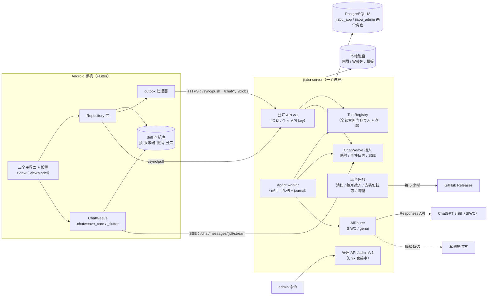
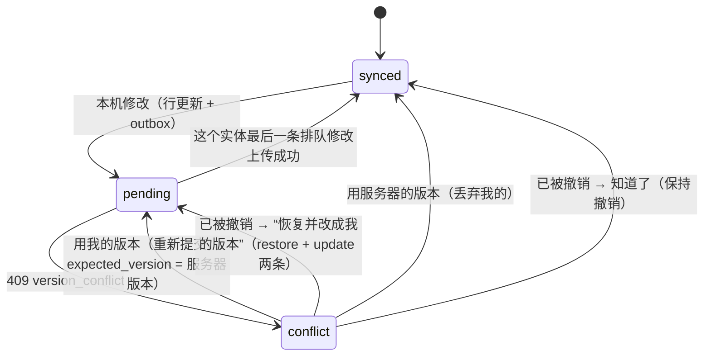
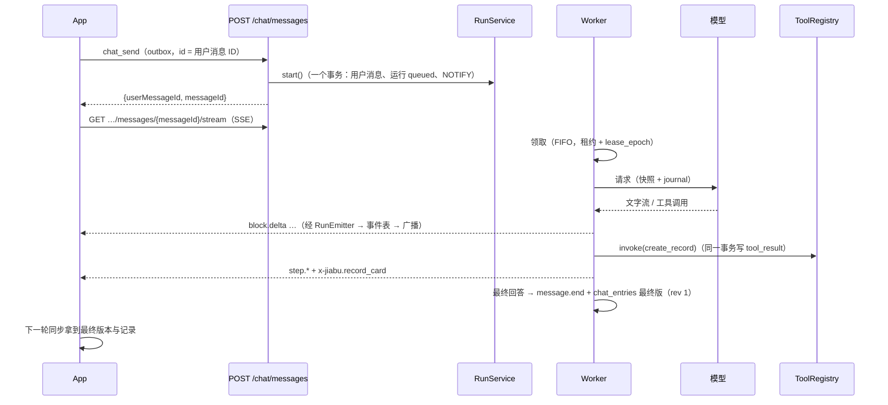

# 家簿 · 技术方案

> 版本 v0.4（2026-10-27）。v0.4：第 13 节已同步进各文档（实施计划 D0）；手动记一笔的种类已定（P65）。v0.3：按 Howard 的决定去掉跨空间移动（P63），第 16 节四件事全部定下（P64）。对应需求 v0.19、决策清单 P1–P65 / C1–C21 / S1–S39 / A1–A20 / G1–G10。v0.2 按第二轮技术评审修订（同步批次与回写、幂等回放与授权的顺序、重试不重复记账、原图引用、跨空间移动、退款不变量、邀请状态、SSE 交接、拉取分页等），需要产品规则的四件事列在第 16 节。
> 本文回答“系统**怎么**搭起来”：模块边界、数据库表、授权、同步、接口、AI 运行时、资料模板协议、客户端补充、部署运维和安全控制。它**不重抄**已有的工程文档，只引用它们的章节并补上缺的部分；实施计划按本文切片。
> 第 14 节“可行性验证”里的实验正在进行，本文按各实验的**期望结果**设计，并写明失败时的退路；结果出来后合并进来。

## 0. 怎么读

- 已有工程文档仍然有效：[客户端](client-flutter.md)（下称“客户端 x.y”）、[服务端](server-rust.md)（“服务端 x.y”）、[AI 层](ai-layer.md)（“AI 层 x.y”）、[设计规范](../design/design-spec.md)、[ChatWeave](https://github.com/zz-howard/chatweave)。
- 本文和它们**有出入的地方**集中列在第 13 节，以本文为准；文档的同步修改放进实施计划。
- 新定下的技术决策已追加进[决策清单](../decisions/README.md)（S25–S39、A16–A20、C15–C21、G10），本文写“为什么”和“怎么做”。
- 第 12 节是“本文定下的待定问题”；第 16 节是需要 Howard 拍板的事。
- 术语第一次出现时附解释；SQL 是建表草案（列名、约束、索引都按实现要求写），以首次迁移为准。

## 1. 系统总览



要点：

1. **一个服务端进程**：公开 API、管理 API（另一个监听器）、Agent worker（2 个 tokio 任务，7.8）和后台任务都在 `server` 二进制里；v1 不做多实例（SSE 广播、事件日志清理都按单进程设计，见 7.4）。
2. **手机以本机库为准**：所有写入先进 drift 和 outbox，再经三个通道上传：`/sync/push`（全部空间内容的写入）、`/chat/*`（发消息、回答、停止）、`/blobs`（原图）。读取靠 `/sync/pull` 增量同步，聊天流式靠 SSE。
3. **写入只有一条路**：手机、个人 API key、AI 三种调用方对空间内容的每一次写入，都是一次 `ToolRegistry::invoke()`（S25，第 6.4 节）。授权、业务校验、审计、变更序号只写一次。
4. **AI 运行**：每条用户消息开一次“运行”（`agent_runs` 一行 + 只追加的 journal），由 worker 领取执行，可以暂停几天（AI 层第 14 节）。

## 2. 仓库与模块边界

### 2.1 仓库（monorepo，S2）

```
jiabu/
  .github/workflows/      server-ci.yml · client-ci.yml · release-server.yml · release-app.yml · golden-image.yml
  client/                 Flutter pub workspace（客户端第 8 节）
  server/                 Cargo workspace（2.2）
    migrations/           纯 SQL 迁移（10.1）
    templates/official/   官方资料模板 JSON（第 8 节，编译进二进制）
    openapi/              openapi.json · openapi-admin.json（CI 检查与代码一致）
  docs/
```

ChatWeave 是独立仓库（G3），家簿按固定提交依赖（10.9）。

### 2.2 服务端 crate

在服务端第 2 节的基础上**新增 `agent`**，并明确每个 crate 的职责：

| crate | 职责 | 依赖 |
|---|---|---|
| `domain` | 纯类型与规则：`Money`、记录种类与余额规则、拨入日期计算、预置分类表、**资料模板协议**（解析、校验、比较口径，第 8 节）、错误代码；无 IO | — |
| `db` | SeaORM 实体（由迁移后的库生成，10.1）；`SpaceTx` / `SystemTx`（4.3）；按空间的仓储函数；同步查询；幂等表 | `domain` |
| `storage` | `object_store` 封装、原图校验与派生尺寸 | `domain` |
| `ai` | `ModelProvider`、`AiRouter`、SIWC / genai 适配器（AI 层第 2–7 节） | `domain` |
| `tools` | `AgentTool` 实现与 `ToolRegistry`（第 6.4 节的全部工具），`ToolCtx`、`authorize()` | `db`、`storage`、`domain` |
| `chat` | ChatWeave 接入：工具结果 → 语义块映射（AI 层 13.2）、`x-jiabu.*` 块 Schema、PostgreSQL 事件日志、消息存储、进程内广播、SSE 辅助 | `db`、`domain`、`chatweave-protocol`、`chatweave-server` |
| `agent`（新） | 运行的生命周期：`RunService`（开始 / 停止 / 重试 / 回答）、worker、`next_action()`、`render_request()`、journal、清扫器、ChatWeave 动作处理器 | `ai`、`tools`、`chat`、`db` |
| `api` | 公开 Router（`/v1`）：提取器、中间件、同步、工具路由生成、utoipa | `agent`、`chat`、`tools`、`db`、`storage` |
| `db-admin` / `admin` / `admin-api` | 管理侧（服务端第 9 节，不变） | — |

依赖方向：`api → agent → {chat, tools, ai} → {db, storage} → domain`。只有 `chat`、`agent`、`api` 依赖 ChatWeave 的 crate（服务端第 2 节写的是 `chat`、`api`；`agent` 因为实现 ChatWeave 的 `ActionHandler` 也要依赖）。管理侧依赖检查不变。另加一条 CI 检查：`crates/api` 里不得出现 `SystemTx`（4.3）。

`bins/server` 里放启动代码和后台任务的调度（10.4）；`bins/admin` 不变。

### 2.3 客户端包

客户端第 8 节的结构不变（`app/` + `packages/jiabu_design`）。本文新增的部分落在：

| 位置 | 内容 |
|---|---|
| `app/lib/data/db/` | drift 表（9.1）、按“服务端 + 账号”打开数据库（9.2） |
| `app/lib/data/sync/` | `SyncEngine`（5.1 的一轮同步）、`OutboxProcessor`、`ConflictService`（5.5） |
| `app/lib/data/media/` | `MediaService`：拍照选图、转 JPEG、算 SHA-256（9.4） |
| `app/lib/data/update/` | `UpdateService`：版本握手、检查与下载安装包（9.6） |
| `app/lib/domain/templates/` | 资料模板的 Dart 模型与默认渲染规则（第 8 节） |

### 2.4 ChatWeave 库

家簿只用库的公开接口（ChatWeave `architecture.md` 第 3、6 节）：服务端用 `chatweave-protocol`（类型、校验、`fold`）和 `chatweave-server`（`MessageStream`、`EventLog` 接口、`sse_response()`、`ActionRegistry`）；客户端实现 `ChatWeaveStore`（drift）、`StreamTransport`（dio）、`ActionTransport`（outbox）。家簿需要、库里还没有的能力一律以通用形式进库（G3）。

## 3. 数据模型

### 3.1 约定

- **主键**：UUIDv7。手机能离线新建的实体（记录、账户、资料、对象、标签、空间、聊天消息）由客户端生成 ID；服务端生成的（成员、会话、运行）用 `default uuidv7()`。
- **金额**：`bigint`，单位是空间币种的最小单位（`*_minor`，人民币即“分”）；币种在空间上（P53），记录上不重复存。`domain::Money` 只接受整数。支持的币种和小数位数是 `domain` 里的固定表（v1：CNY、HKD、USD、EUR、GBP、JPY）。
- **时间**：时刻一律 `timestamptz`；“记账日期”“事件日期”是 `date`，按空间时区（`spaces.timezone`）解释。
- **枚举**：`text + check`，不用 PostgreSQL 的 enum 类型（加值不用改类型）。
- **乐观并发**：可被修改的实体都有 `version int`，每次修改 +1；写入带 `expected_version`。
- **同步列**：会同步到手机的表都有 `change_seq bigint not null` 和索引 `(space_id, change_seq)`（5.4）。
- **软删除**：记录 / 资料“作废”（`status = 'voided'`，P2 的撤销）；账户、对象“归档”（`archived_at`）；标签、无关联的对象“删除”（`deleted_at`）。同步下发的就是带这些标记的行，即“墓碑”（tombstone：删除后留下的标记行，让手机知道要删掉本地那份）。只有删除空间（3.10）才物理删除内容。
- **模块列**：内容表带 `module`（`ledger` / `documents`）和预留的 `visibility jsonb`（S13，v1 恒为空、不读）。聊天表不带（见 13 节第 6 条）。

### 3.2 账号、会话、API key

```sql
create table users (
  id uuid primary key default uuidv7(),
  username text not null,
  password_hash text not null,                      -- Argon2id PHC 字符串（服务端 3.1）
  locale text not null default 'system' check (locale in ('system','zh-Hans','en')),   -- P48，跨设备同步
  must_change_password boolean not null default false,
  admin_reset_at timestamptz,                       -- 最近一次管理员重置密码的时间（P49）
  admin_reset_notice_pending boolean not null default false,  -- 下一次正常登录时随响应返回一次后清掉
  disabled_at timestamptz,
  password_changed_at timestamptz,
  created_at timestamptz not null default now());
create unique index users_username on users (lower(username));

create table sessions (
  id uuid primary key default uuidv7(),
  token_hash bytea not null unique,                 -- sha256(令牌)
  user_id uuid not null references users,
  kind text not null check (kind in ('full','password_change')),   -- password_change：只能调改密码接口，15 分钟有效
  device_name text,
  created_at timestamptz not null default now(),
  expires_at timestamptz not null,                  -- full：最后活跃 + 180 天（滑动，last_seen_at 最多每天写一次）
  last_seen_at timestamptz not null default now());
create index sessions_user on sessions (user_id);

-- api_keys、api_key_audit：照服务端 5.1（不变）
create table idempotency (
  user_id uuid not null references users,
  key text not null,                                -- Idempotency-Key / outbox op_id / 动作 ID
  request_hash bytea not null,                      -- sha256(方法 + 路径 + 规范化后的请求体)
  response_status smallint, response_body jsonb,    -- API key 创建接口只存 key 的 ID，不存明文（服务端 3.3）
  created_at timestamptz not null default now(),
  primary key (user_id, key));
create index idempotency_created on idempotency (created_at);   -- 90 天后清理（3.11）
```

### 3.3 空间与成员

```sql
create table spaces (
  id uuid primary key,                              -- 客户端生成（在线创建，ID 让重试幂等）
  name text not null check (char_length(name) between 1 and 40),
  accent_color text not null,                       -- 色板键名（C10）
  currency char(3) not null default 'CNY',          -- 建空间时选，之后不可改（P53）
  timezone text not null,                           -- IANA 时区名，默认取建空间时手机的时区（P55）
  is_default boolean not null default false,
  created_by_user_id uuid not null references users,
  created_at timestamptz not null default now(),
  deleted_at timestamptz,                           -- 删除空间（P57）；内容随后物理删除，这一行留给用量统计（3.10）
  version int not null default 1, change_seq bigint not null);
create unique index one_default_space_per_user on spaces (created_by_user_id) where is_default;

create table space_members (
  id uuid primary key default uuidv7(),
  space_id uuid not null references spaces,
  user_id uuid not null references users,
  display_name text not null check (char_length(display_name) between 1 and 20),
  role text not null check (role in ('owner','member')),
  status text not null check (status in ('active','left')),
  left_reason text check (left_reason in ('left','removed','space_deleted')),
  join_epoch int not null default 1,                -- 每次（重新）加入 +1；手机和 outbox 用它识别“中间退出过”（5.6）
  joined_at timestamptz not null, left_at timestamptz,
  version int not null default 1, change_seq bigint not null,
  unique (space_id, user_id));                      -- 重新加入复用同一行（P13）
create index space_members_user on space_members (user_id) where status = 'active';

-- 邀请（P62）：对方接受后才成为成员
create table space_invitations (
  id uuid primary key default uuidv7(),
  space_id uuid not null references spaces,
  invitee_user_id uuid not null references users,
  invited_by_member_id uuid not null references space_members,
  status text not null check (status in ('pending','accepted','declined','cancelled')),
  created_at timestamptz not null default now(), decided_at timestamptz);
create unique index one_pending_invitation on space_invitations (space_id, invitee_user_id) where status = 'pending';
create index space_invitations_invitee on space_invitations (invitee_user_id) where status = 'pending';

-- space_member_grants、space_events：照服务端 5.1（不变）
```

**邀请的流程**（P62、P71）：空间所有者按用户名邀请 → 生成一条 `pending` 邀请，对方**还不是成员**，看不到这个空间的任何内容。被邀请的人在 App 里看到“谁邀请你加入哪个空间”（只有空间名和邀请人的显示名），可以接受或拒绝；接受之前，当前所有者可以撤回任何一条待接受的邀请，邀请人本人（转让前发出的）也可以撤回自己发的。接受 = 同一事务里把邀请改为 `accepted`，并新建成员行（`role = 'member'`）或把以前的成员行重新激活（`status = 'active'`、`join_epoch + 1`，P13 的“重新加入”）。拒绝或撤回后邀请人看到对应状态，可以再次邀请。不设过期时间。已是活跃成员、默认个人空间（P11）不能邀请。邀请和接受都只能在线、只能用会话（不进 outbox，API key 不能调用）。

**邀请的状态转换**（S38、P71）：只有所有者能邀请（与改名、移除、转让同一个所有者校验，非所有者按 404 `not_found` 处理）。撤回允许当前所有者或邀请人本人。接受、拒绝、撤回都在该空间的锁（4.3）里做一次条件写入 `UPDATE space_invitations SET status = … WHERE id = $1 AND status = 'pending'`，影响 0 行就按当前状态返回（例如撤回先到，接受返回 404 `not_found`，界面提示“邀请已失效”），所以接受和撤回并发时只有一个生效。接受还要在同一事务里确认：请求者就是 `invitee_user_id`；空间未删除。邀请代表空间发出，**邀请人之后退出、被移出或转让所有者都不影响**待接受的邀请（P71 取代 P64③），当前所有者可以撤回；删除空间时把该空间所有 `pending` 邀请改为 `cancelled`（3.10）。

“最后一位所有者不能退出”（P18）、“删除只在只剩自己时允许”（P57）在服务层判断（需要计数，放在 4.3 的空间锁里做，没有竞态）。

### 3.4 账本（module = `ledger`）

```sql
create table accounts (
  id uuid primary key, space_id uuid not null references spaces,
  module text not null default 'ledger' check (module = 'ledger'), visibility jsonb,
  kind text not null check (kind in ('real','purpose')),      -- 真实资金账户 / 逻辑用途账户（P4）
  name text not null check (char_length(name) between 1 and 30),
  is_reserve boolean not null default false,        -- 备用金：超支调拨的推荐来源、退款到已归档用途时的默认去处（P5、P53）
  opening_balance_minor bigint not null default 0,  -- 起始余额（P3），可正可负
  opening_on date not null,                         -- 起始余额对应的日期
  sort_key int not null default 0,
  created_by_member_id uuid not null references space_members,
  archived_at timestamptz,                          -- “移除”= 归档，余额须为 0（P37）
  version int not null default 1, change_seq bigint not null,
  created_at timestamptz not null, updated_at timestamptz not null,
  check (not is_reserve or kind = 'purpose'));
create unique index accounts_one_reserve on accounts (space_id) where is_reserve and archived_at is null;
create unique index accounts_name on accounts (space_id, kind, lower(name)) where archived_at is null;
create index accounts_sync on accounts (space_id, change_seq);

create table allocation_plans (                     -- 用途账户的每月拨入计划（P55）
  account_id uuid primary key references accounts,
  space_id uuid not null references spaces,
  amount_minor bigint not null check (amount_minor > 0),
  day_of_month smallint not null check (day_of_month between 1 and 31),
  enabled boolean not null default true,            -- “自动执行可开关”
  next_run_on date not null,                        -- 下一次拨入日（空间时区）；设好时取“下一个”拨入日
  last_run_month char(7),                           -- 'YYYY-MM'，同一个月不拨第二次
  version int not null default 1, change_seq bigint not null, updated_at timestamptz not null);
create index allocation_plans_due on allocation_plans (next_run_on) where enabled;
create index allocation_plans_sync on allocation_plans (space_id, change_seq);

create table tags (
  id uuid primary key, space_id uuid not null references spaces,
  module text not null default 'ledger' check (module = 'ledger'),
  preset_key text,                                  -- 预置分类的固定身份，如 'dining'（7.6）
  name text,                                        -- 空 = 没改过名，按查看者界面语言显示预置名；非空 = 所有人共用的名字（P48）
  created_by_member_id uuid references space_members,   -- 预置标签为空
  deleted_at timestamptz,
  version int not null default 1, change_seq bigint not null,
  check (preset_key is not null or name is not null));
create unique index tags_preset on tags (space_id, preset_key) where preset_key is not null;
create index tags_sync on tags (space_id, change_seq);

create table records (
  id uuid primary key, space_id uuid not null references spaces,
  module text not null default 'ledger' check (module = 'ledger'), visibility jsonb,
  kind text not null check (kind in ('expense','income','transfer','allocation','reallocation','refund')),
  amount_minor bigint not null check (amount_minor > 0),
  occurred_on date not null,
  account_id uuid references accounts,              -- 真实账户：支出 / 收入 / 退款的账户，转账的转出方
  to_account_id uuid references accounts,           -- 转账的转入方
  purpose_id uuid references accounts,              -- 用途账户：支出 / 退款 / 拨入的用途，调拨的调出方
  to_purpose_id uuid references accounts,           -- 调拨的调入方
  refund_of_id uuid references records,             -- 退款挂在哪笔支出上（P53）
  tag_ids uuid[] not null default '{}',
  note text check (char_length(note) <= 500),
  attachments text[] not null default '{}',         -- 原图 SHA-256（十六进制），须在本空间 blob_refs 里
  status text not null default 'active' check (status in ('active','voided')),
  void_reason text check (void_reason in ('user')),
  origin text not null check (origin in ('chat','manual','api','allocation')),
  run_id uuid,                                      -- AI 写入时所属的运行
  created_by_member_id uuid references space_members,   -- 系统拨入为空
  updated_by_member_id uuid references space_members,
  version int not null default 1, change_seq bigint not null,
  created_at timestamptz not null, updated_at timestamptz not null,
  constraint records_shape check (
    (kind = 'expense'      and account_id is not null and purpose_id is not null and to_account_id is null and to_purpose_id is null and refund_of_id is null) or
    (kind = 'income'       and account_id is not null and purpose_id is null     and to_account_id is null and to_purpose_id is null and refund_of_id is null) or
    (kind = 'transfer'     and account_id is not null and to_account_id is not null and purpose_id is null and to_purpose_id is null and refund_of_id is null) or
    (kind = 'allocation'   and purpose_id is not null and account_id is null     and to_account_id is null and to_purpose_id is null and refund_of_id is null) or
    (kind = 'reallocation' and purpose_id is not null and to_purpose_id is not null and account_id is null and to_account_id is null and refund_of_id is null) or
    (kind = 'refund'       and account_id is not null and purpose_id is not null and refund_of_id is not null and to_account_id is null and to_purpose_id is null)));
create index records_sync on records (space_id, change_seq);
create index records_date on records (space_id, occurred_on);
create index records_account on records (account_id) where status = 'active';
create index records_to_account on records (to_account_id) where status = 'active';
create index records_purpose on records (purpose_id) where status = 'active';
create index records_to_purpose on records (to_purpose_id) where status = 'active';
create index records_refund_of on records (refund_of_id) where status = 'active';
create index records_tags on records using gin (tag_ids);
```

**余额不落库，按记录推导**（服务端 5.2 第 4 条）：

| 账户 | 余额 = 起始余额 + |
|---|---|
| 真实账户 | 收入 − 支出 + 退款（`account_id`）− 转出 + 转入（`to_account_id`） |
| 用途账户 | 拨入 − 支出 + 退款（`purpose_id`）− 调出 + 调入（`to_purpose_id`） |

只算 `status = 'active'` 的记录。两人规模下按需 `SUM` 足够（有部分索引）；手机用同一套规则从本机库算，所以离线也有余额。“消费只计一次”：统计消费时只看 `kind = 'expense'` 减去它的退款，拨入、调拨、转账都不算收入或消费（P4、需求第 6 节）。

**每月拨入**：后台任务每小时扫一次 `next_run_on <= 空间时区的今天` 的计划，在该空间的事务里插入一条 `allocation` 记录，ID = `uuidv5(account_id, 'YYYY-MM')`、`ON CONFLICT DO NOTHING`（同一个月最多一次），写 `last_run_month`，再把 `next_run_on` 推到下个月的拨入日（29–31 号遇小月取月末）。停机跨过几个拨入日时循环补到今天为止，每个月一条（P55）。设置或修改计划时 `next_run_on` = 今天之后的第一个拨入日，且月份不等于 `last_run_month`。拨入记录的撤销与普通记录相同。

**退款**：原用途已归档时工具要求显式给出 `purpose_id`（AI 会先问，默认备用金，P53）。“一笔支出的有效退款之和 ≤ 它的金额，且退款只挂在有效的支出上”是一条**不变量**（S39），凡是可能破坏它的写入都在同一空间锁内检查，不只是新建退款：

| 写入 | 检查 |
|---|---|
| `create_record(kind = refund)` | 原记录是本空间的有效**支出**（作废的返回 422 `parent_voided`）；已有有效退款 + 本次 ≤ 原金额，否则 422 `refund_exceeds_original` |
| `update_record` 改退款的金额 | 同上（把本条旧金额换成新金额再算）；`refund_of_id` 建好后不能改 |
| `update_record` 改支出的金额 | 新金额 ≥ 它的有效退款之和，否则 422 `refund_exceeds_original` |
| `restore_record` 恢复退款 | 原支出有效，且恢复后不超额，否则 `parent_voided` / `refund_exceeds_original` |
| `void_record` 撤销还有有效退款的支出 | 拒绝，422 `has_refunds`：先撤销退款（P64）。AI 收到这个错误会问“这笔还有 1 笔退款，要一起撤销吗”，确认后依次撤销 |

撤销退款、恢复支出不会破坏不变量，不用额外检查。

#### 3.4.1 不做跨空间移动

v1 不做把记录从一个空间移到另一个空间（P63，取代 P16、P60）：记错空间时在原空间撤销、到正确的空间重新记。所以没有 `move_record` 工具、记录上没有移动关联列、`entity_events` 没有 `move_out` / `move_in`，也不需要“另一个空间名字不外泄”的关联过滤。

### 3.5 资料（module = `documents`）

```sql
create table subjects (                             -- 资料关联的“对象”（P44、P58）
  id uuid primary key, space_id uuid not null references spaces,
  module text not null default 'documents' check (module = 'documents'), visibility jsonb,
  kind text not null check (kind in ('family_member','pet','property','vehicle','other')),
  name text not null check (char_length(name) between 1 and 30),   -- 存储前做 NFKC + 去首尾空白
  member_id uuid references space_members,          -- 家人正好是空间成员时可以绑定（可空）
  archived_at timestamptz,
  deleted_at timestamptz,                           -- 只有没关联任何资料的对象才能删除
  created_by_member_id uuid not null references space_members,
  version int not null default 1, change_seq bigint not null,
  created_at timestamptz not null, updated_at timestamptz not null);
create unique index subjects_name on subjects (space_id, kind, lower(name)) where deleted_at is null;   -- 已归档的也占名（P58）
create index subjects_sync on subjects (space_id, change_seq);

create table documents (
  id uuid primary key, space_id uuid not null references spaces,
  module text not null default 'documents' check (module = 'documents'), visibility jsonb,
  template_id text,                                 -- 如 'jiabu.checkup'；无模板为空（第 8 节）
  template_version int,
  title text not null check (char_length(title) between 1 and 60),
  event_date date not null,                         -- 时间线日期：模板声明的事件日期字段，无模板默认录入日期（P44）
  subject_ids uuid[] not null default '{}',
  content jsonb not null,                           -- {"v":1,"items":[…]}，格式见 8.3
  status text not null default 'active' check (status in ('active','voided')),
  origin text not null check (origin in ('chat','manual','api')),
  run_id uuid,
  created_by_member_id uuid not null references space_members,
  updated_by_member_id uuid not null references space_members,
  version int not null default 1, change_seq bigint not null,
  created_at timestamptz not null, updated_at timestamptz not null);
create index documents_sync on documents (space_id, change_seq);
create index documents_timeline on documents (space_id, event_date desc) where status = 'active';
create index documents_template on documents (space_id, template_id, event_date) where status = 'active';
create index documents_subjects on documents using gin (subject_ids);
```

- **同名沿用**（P58）：`create_subject` 先按 `(space_id, kind, lower(name))` 查（含已归档）：有已归档的就取消归档并返回它，有在用的就直接返回它；都没有才插入。同一空间锁内完成，唯一索引兜底。
- **对象只能归档、不能删除**的条件 = 存在 `subject_ids @> {id}` 的资料（含已作废的，因为作废可以恢复）。
- **模板快照**：服务端记下每个模板 ID 最近一次成功加载的内容，用来检查模板修改是否兼容（8.6）：

```sql
create table template_snapshots (id text primary key, version int not null, body jsonb not null,
  loaded_at timestamptz not null default now());   -- 不属于任何空间，不启用 RLS
```

- **AI 多次追问时的草稿**：不建“草稿资料”行。追问期间半成品在运行 journal 里（模型给出的工具参数），原图已经作为聊天消息的附件存好；停止或过期时这一份资料不保存，收尾文字说明“资料没有保存，原图在上面这条消息里”。一次暂停只问一件事，同一条回复可以暂停多次（AI 层 14.4）。

### 3.6 变更记录（审计）

服务端 5.1 的 `record_events` 推广为 `entity_events`，账户、计划、标签、资料、对象的修改记录都在这里（P44 的“完整修改记录”、P58 的“改关联留下记录”）：

```sql
create table entity_events (
  id bigint generated always as identity primary key,
  space_id uuid not null references spaces,
  entity_kind text not null check (entity_kind in ('record','account','allocation_plan','tag','document','subject')),
  entity_id uuid not null,
  kind text not null check (kind in ('create','update','void','restore','archive','unarchive','delete')),
  before jsonb, after jsonb,                        -- 实体的完整快照（只含该实体自己的列）
  actor_member_id uuid references space_members,    -- 系统拨入为空
  via_api_key_id uuid references api_keys, via_api_key_name text,   -- 通过 API key（服务端 3.3）
  run_id uuid, request_id uuid,
  at timestamptz not null default now(),
  change_seq bigint not null);
create index entity_events_entity on entity_events (entity_id, id);
create index entity_events_sync on entity_events (space_id, change_seq);
```

只追加：`jiabu_app` 对它只有 `INSERT` / `SELECT`。撤销 = 追加 `void` 事件并更新实体当前态。

### 3.7 原图

服务端 5.3 的 `blobs` 不变（`mime` 只允许 `image/jpeg`，客户端统一转 JPEG）。`blob_refs` 加上模块，按模块鉴权；聊天里发的图属于 `chat`，只有上传者本人能读（对话一对一，P23）：

```sql
create table blob_refs (
  id uuid primary key default uuidv7(),
  space_id uuid not null references spaces,
  module text not null check (module in ('ledger','documents','chat')),
  sha256 bytea not null references blobs,
  uploaded_by_member_id uuid not null references space_members,   -- chat：这条引用的主人；ledger / documents：第一次上传的人（只作记录）
  created_at timestamptz not null default now());
-- 聊天的图每位成员各有一条引用（两人各自发了同一张图，各自都能看）；业务模块每个空间每张图一条
create unique index blob_refs_chat on blob_refs (space_id, sha256, uploaded_by_member_id) where module = 'chat';
create unique index blob_refs_module on blob_refs (space_id, module, sha256) where module <> 'chat';
```

物理文件按哈希只存一份；**逻辑引用**按上面两条唯一索引分开（S35）。上传时 `ON CONFLICT DO NOTHING` 按模块落到对应的索引上，所以第二位成员上传同一张聊天图也会得到自己的引用，响应与第一次完全相同，看不出别人传过。

文件布局 `<data_dir>/blobs/{前 2 位}/{sha256}.{orig|1600|512}.jpg`：原图、给 AI 和详情页的 1600px 版、512px 缩略图，后两者去掉 EXIF。

**原图存的是照片本身**（P70）：服务端写盘前清理一遍 JPEG——只保留到第一个图像结束标记为止（“实况照片”的小视频、MPF 嵌入的其他图片都在它后面，一律丢掉）；去掉 XMP、扩展 XMP 和 APP13（IPTC）段；EXIF 里去掉 GPS 后重写，重写失败就整段去掉（已读出的方向照用）。画质不动：不缩小、不重新压缩。哈希按手机上传的内容算（5.8 校验的是上传内容），存下的文件是清理后的版本；同一张图无论谁传、传几次，清理结果相同。

AI 把聊天里的照片挂到记录或资料上时（`attachments`、资料的 `image` 值），工具在同一事务里为目标模块补一条 `blob_refs`（只允许引用调用者本人有引用的 `chat` 图，或本空间该模块已有的图），之后空间里有该模块读权限的成员都能看到原图。

**编辑时去掉照片（P67）**：`update_record` 让 `attachments` 少了某个哈希、`update_document` 让资料内容里少了某个 `image` 值时，工具在同一个写事务里（已持有空间锁）检查：本空间还有没有任何记录的 `attachments`（含 `status = 'voided'` 的）或任何资料的 `image` 值（含已作废的）引用这个哈希；`ledger` 与 `documents` 分开看，各自都没有了就删掉该模块的那条 `blob_refs`。删除触发 S4 的生命周期触发器：这张图在全服务器都没有引用时开始计时，1 天后由原图清理任务删掉文件（3.11）。

- **撤销 / 作废不删引用**：撤销的记录、作废的资料还能恢复（`restore_record` 等），照片要跟着回来，所以 `void_*` 工具不碰 `blob_refs`。
- **聊天的引用不受影响**：聊天记录不会删除，成员自己聊天里的图（`chat` 引用）一直保留；所以从聊天挂到账上、又从账上去掉的照片，在那位成员的聊天里仍然能看。
- **变更记录**：`entity_events` 的前后快照里仍有这个哈希；手机显示为“移除了一张照片”，不提供打开。之后如果下载，引用已经没有了就是 404，与“无权”相同。
- **再挂回去**：编辑时重新加上这张图，与第一次一样要求本空间该模块有引用，所以手机要先重新上传（5.8，响应与第一次相同）。

#### 3.7.1 照片占用（P68、S40）

`blobs` 加一列 `stored_bytes bigint not null`：原图和两个派生尺寸三个文件的字节数之和，上传时生成派生尺寸后写入（5.8）。已有的行由迁移后的一次性任务按文件大小补齐。

**一个空间的占用** = 本空间所有 `blob_refs`（不分模块、不分成员）引用到的**不同**照片的 `stored_bytes` 之和：

```sql
select count(*) as files, coalesce(sum(b.stored_bytes), 0) as bytes
from (select distinct sha256 from blob_refs where space_id = $1) r
join blobs b using (sha256);
```

同一张图在本空间被账、资料和几位成员的聊天同时引用，只算一次；别的空间有没有这张图不影响本空间的数字（跨空间各算各的，否则数字的变化会泄露别的空间的内容）。数据库里的记录不算。

```sql
-- 每天每个空间一行；同一天重跑覆盖（ON CONFLICT (space_id, day) DO UPDATE）
create table space_storage_daily (
  space_id uuid not null references spaces,
  day date not null,                 -- UTC 日期
  files int not null,                -- 不同照片的张数
  bytes bigint not null,             -- 原图 + 两个派生尺寸
  measured_at timestamptz not null,
  primary key (space_id, day));
-- 全服务器实际占用：所有 blobs 的 stored_bytes 之和（同一张图只存一份；含还在等清理的）
create table storage_daily_totals (
  day date primary key, files int not null, bytes bigint not null, measured_at timestamptz not null);
```

- **快照任务**：每天一次，在原图清理之后跑（10.4），用 `SystemTx` 对每个未删除的空间算一次、写一行，再写全服务器一行。停机错过的日子不补（补不回当天的真实数字），将来计费按有记录的日子折算。已删除的空间不再写新行，旧行保留。
- **两张快照表只有 ID、日期和数字**，没有任何内容：`jiabu_admin` 只能 `SELECT` 这两张表（服务端 9.2），仍然读不到 `blobs` / `blob_refs`，管理侧“看不到内容”的保证不变。
- **App 里的数字是实时的**：`GET /spaces/{id}/storage` 在 `SpaceTx`（只读）里跑上面的查询，返回 `{files, bytes}`；空间的活跃成员都能看（不按模块权限拆，只给总数，不按模块或成员细分）。总数里含其他成员聊天里的图，这只是一个合计数字，接受这一点。
- 首版只统计和展示，不收费、不设上限（P68）。

### 3.8 聊天与 AI 运行

- `chat_entries`、`chat_stream_events`、`chat_actions`：照服务端 5.1，改动：`chat_entries` 去掉 `module` / `visibility`（13 节第 6 条）；三张表都有 `space_id uuid not null` 和 `member_id uuid not null`（会话所属成员，冗余一份给 RLS 和同步过滤用；服务端 5.1 的 `chat_stream_events` 原来只有 `message_id`，这里补上两列）；助手消息加 `reply_to_id uuid`（回答的是哪条用户消息，供“重试”用）。
- `conversations`：v1 每位成员在每个空间**一段连续的对话**：

```sql
create table conversations (
  id uuid primary key default uuidv7(),
  space_id uuid not null references spaces,
  member_id uuid not null references space_members,
  created_at timestamptz not null default now(),
  change_seq bigint not null,
  unique (space_id, member_id));
```

- `agent_runs`、`agent_run_items`、`agent_tool_calls`、`agent_prompt_snapshots`：照 AI 层 14.2，改动：`kind` 只有 `'chat'`（A16）；加 `input_entry_id uuid not null`（触发这次运行的用户消息）、`join_epoch int not null`（运行开始时发起成员的 `join_epoch`，7.5 比对用）、`retry_of_run_id uuid references agent_runs`（重试接着哪次运行做，7.3）；v1 不建子 Agent 的 `parent_run_id` / `parent_call_id` 两列，`agent_tool_calls.effect` 只允许 `read` / `local_write`（A20，7.8）；唯一索引改为只管 `running` / `paused`（A17，7.3）：

```sql
create unique index one_active_run_per_conversation on agent_runs (conversation_id)
  where status in ('running','paused');
create index agent_runs_conversation_fifo on agent_runs (conversation_id, created_at)
  where status in ('queued','running','paused','waiting_ai');
create unique index one_retry_per_run on agent_runs (retry_of_run_id) where retry_of_run_id is not null;   -- 7.3
```

- `ai_calls`、`ai_step_meters`：照 AI 层第 8 节。`task_kind` 的取值改为 `chat` / `chat_vision` / `probe`（A16）。

### 3.9 安装包与运维

```sql
create table app_releases (
  build int primary key,                            -- Android versionCode；正式版、测试版共用一个递增序列
  version text not null,                            -- 语义化版本，如 '1.3.0'
  channel text not null check (channel in ('stable','beta')),
  abi text not null default 'arm64-v8a',
  sha256 bytea not null, bytes bigint not null,
  cert_sha256 bytea not null,                       -- 安装包签名证书的 SHA-256（与配置里固定的指纹比对）
  min_server_api int not null,                      -- 这个 App 需要的服务端 API 版本
  security_force boolean not null default false,    -- 严重安全修复：强制更新（P47b）
  notes jsonb not null,                             -- {"zh-Hans": "…", "en": "…"}
  source text not null check (source in ('github','manual')),
  status text not null check (status in ('available','rejected','withdrawn')),
  reject_reason text,
  published_at timestamptz, fetched_at timestamptz not null default now());
```

`jiabu_app` 只读；`jiabu_admin` 读写（管理 API 新增接口见 13 节第 9 条）。

### 3.10 数据库角色、RLS 与删除空间

- **三个登录角色**：`jiabu_owner`（拥有全部表，只用于跑迁移）、`jiabu_app`（公开 API 与 worker）、`jiabu_admin`（管理侧，列级授权照服务端 9.2，加上 `users.admin_reset_at` 等新列和 `app_releases`）。
- **RLS**（行级安全，PostgreSQL 按策略自动给每条查询加过滤条件）：内容表对 `jiabu_app` 启用，条件是“本事务允许的空间”，见 4.4。
- **只追加的表**：`entity_events`、`space_events`、`chat_actions`、`api_key_audit`、`admin_audit` 对应用角色只有 `INSERT` / `SELECT`。
- **删除空间**（P57）：在空间锁里校验“只剩请求者一人、名字一致、不是默认空间”→ `spaces.deleted_at = now()`、成员 `status = 'left'`、`left_reason = 'space_deleted'`、取消这个空间里所有未结束的运行、所有 `pending` 邀请改为 `cancelled`。随后后台任务调用 `purge_space(space_id)`：一个 `SECURITY DEFINER` 函数（以函数所有者 `jiabu_owner` 的权限执行，所以能删只追加表），只在 `deleted_at` 非空时工作，按外键顺序删掉该空间的全部内容行（含 `entity_events`、聊天、运行、`blob_refs`）；没有引用的原图由原图清理任务删除。`spaces` 行、`space_members` 行和 `ai_calls` 保留：管理侧用量统计还要按空间名称显示（P30），名称以外的内容都已删除。

### 3.11 保留期

| 数据 | 保留 | 执行 |
|---|---|---|
| `chat_stream_events` | 消息结束或暂停后 10 分钟（服务端 5.2） | 清理任务每分钟 |
| journal 的 `provider_blob` / journal 原文 | 运行结束 7 天 / 30 天（AI 层 14.9） | 每天 |
| `idempotency` | 90 天（outbox 里放更久的写入仍安全：新建靠客户端 ID 去重，修改靠 `expected_version`） | 每天 |
| `api_key_audit` | 180 天（服务端 3.3） | 每天 |
| 过期会话 | 到期即删 | 每天 |
| 没有引用的原图 | 最后一个引用消失 1 天后（编辑时去掉照片会让引用消失，3.7） | 每天 |
| `space_storage_daily`、`storage_daily_totals` | 不过期（将来计费的依据，3.7.1） | — |
| 删除空间的内容 | 立即（3.10） | 删除后的后台任务 |
| 其余业务数据、`entity_events`、`ai_calls` | 不过期 | — |

## 4. 授权

### 4.1 身份：`Principal`

照服务端 3.3：`Principal { user_id, via: Session { session_id, kind } | ApiKey { id, name, scope } }`。提取器顺序：令牌格式 → 查库（会话 / key，账号未停用）→ `password_change` 会话只能访问 `POST /me/password` → 接口类别是否允许这种身份（服务端 3.3 的表，`SessionOnly` 提取器）。

### 4.2 一个授权函数

```rust
// crates/tools —— 唯一的授权入口（S13）
pub enum Module { Ledger, Documents }
pub enum Action { Read, Write, Manage }
pub fn authorize(member: &ActiveMember, module: Module, action: Action) -> Result<(), NotFound>;
```

- `ActiveMember` 只能由 `SpaceTx::member()` 构造（下一节）：它已经确认了“这个用户在这个空间是活跃成员”。
- 级别 `none < read < write < manage`；`Read` 需要 ≥ `read`，`Write` ≥ `write`，`Manage` ≥ `manage`。**v1 没有任何动作要求 `Manage`**：P21 规定 v1 所有成员默认全开，加入时 owner 写 `manage`、member 写 `write`，两者在 v1 能做的事相同。
- 空间级的管理（改名、邀请、移除、转让、删除）看的是 `space_members.role`，不是模块级别；只有会话能调用。
- 不满足一律 `NotFound`（404）。API key 的只读限制在授权之前判断，返回 403 `api_key_read_only`（服务端 3.3）。
- 聊天的“只有本人能看自己的会话”不在 `authorize()` 里，而在聊天仓储的查询条件里（`member_id = 本人`）。

### 4.3 `SpaceTx`：所有空间数据都在它里面读写

```rust
// crates/db
pub struct SpaceTx { tx: DatabaseTransaction, user_id: UserId, members: Vec<ActiveMember> }
impl SpaceTx {
    /// 开事务 → 对每个空间取事务级咨询锁（写入时）→ 确认请求者在这些空间都是活跃成员（否则 NotFound）
    /// → 请求带了 join_epoch 的空间逐个比对（否则 MembershipChanged，6.1）
    /// → set_config('jiabu.space_ids', '{…}', true) → 返回。
    pub async fn begin(db: &AppDb, user: UserId, spaces: &[(SpaceId, Option<JoinEpoch>)], mode: Mode) -> Result<Self, BeginError>;
    pub fn member(&self, space: SpaceId) -> &ActiveMember;
}
/// 只给后台任务用（worker 领取、清扫器、每月拨入、清理、删除空间）；crates/api 里禁止出现（CI 检查）。
pub struct SystemTx { /* set_config('jiabu.system', 'on', true) */ }
```

- `db` crate 不导出连接池，仓储函数只接收 `&SpaceTx`（或 `&SystemTx`）。业务代码拿不到“裸连接”，也就写不出不带空间的查询。
- **写入时的空间锁**：`Mode::Write` 先 `SELECT pg_advisory_xact_lock(hashtextextended(space_id::text, 0))`（事务级咨询锁：PostgreSQL 提供的、按一个数字加锁、事务结束自动释放的轻量锁）。同一空间的写事务因此串行，这保证了 5.4 的“同一空间内变更序号的顺序 = 提交顺序”，也让退款上限、最后一位所有者、同名对象这类“先查再写”的规则没有竞态。一个写事务只锁一个空间（没有跨空间写入，P63），不会死锁。
- 每个写事务里分配变更序号统一用 `nextval('change_seq')`，**必须在加锁之后**调用（`SpaceTx` 提供 `next_seq()`，内部断言已加锁）。`SystemTx` 写某个空间的数据（每月拨入、运行收尾）时同样先 `lock_space(space_id)` 再取号。

### 4.4 RLS：第二道防线（待定问题 12）

**决定：内容表对 `jiabu_app` 启用 RLS，条件只有一条“空间在本事务的允许列表里”**（S27）。

```sql
create function jiabu_allowed_spaces() returns uuid[] language sql stable as $$
  select coalesce(nullif(current_setting('jiabu.space_ids', true), '')::uuid[], '{}') $$;
create function jiabu_system() returns boolean language sql stable as $$
  select coalesce(current_setting('jiabu.system', true), '') = 'on' $$;
-- 对每张内容表：
alter table records enable row level security;
create policy space_scope on records to jiabu_app
  using (space_id = any (jiabu_allowed_spaces()) or jiabu_system())
  with check (space_id = any (jiabu_allowed_spaces()) or jiabu_system());
```

- **启用的表**：`accounts`、`allocation_plans`、`tags`、`records`、`entity_events`、`subjects`、`documents`、`blob_refs`、`conversations`、`chat_entries`、`chat_stream_events`、`chat_actions`、`agent_runs`。`agent_run_items` / `agent_tool_calls` 没有 `space_id`，只按运行 ID 访问（先在 RLS 下读到运行行），不启用。`spaces`、`space_members`、`space_member_grants` 是计算允许列表的依据，不启用（`GET /spaces` 只按 `user_id = 本人` 查，有集成测试）。
- **为什么要**：空间隔离是产品的第一承诺（P10），而“某个查询漏写 `space_id` 条件”是 AI 写代码时**最可能**出的错；RLS 的检查在数据库里、**默认关闭**（没设置允许列表就一行也读不到、写不进），可靠。两条都满足 Howard 对加防护的要求。
- **为什么只放空间、不放模块权限和对话归属**：那两条依赖业务语义（模块映射、会话所属），写进 SQL 策略就成了第二套权限逻辑，容易和 `authorize()` 走样；它们由 4.2 的唯一入口和集成测试负责。
- **`SystemTx` 是唯一的绕过开关**：只在 `bins/server` 的后台任务和 `agent` 的领取 / 清扫函数里用；worker 领到运行后立刻改用该运行空间的 `SpaceTx` 执行。
- 退路（实验 E2 失败时）：不启用 RLS，保留 `SpaceTx` 唯一入口，另加“隔离矩阵”集成测试（每个接口 × 非成员 / 已退出 / 别的空间的 ID），见第 14 节。

## 5. 同步协议

### 5.1 一轮同步

手机的 `SyncEngine` 在这些时机跑一轮：回到前台、网络恢复、outbox 有新条目（防抖 1 秒）、收到某条回复的 `message.end`、下拉刷新、workmanager 兜底（客户端 3.3）。同一时间只有一轮（客户端 3.2 的锁）。

1. **版本握手**：`GET /meta`（6.1），App 或服务端太老就停在这里（9.6）。
2. **成员关系**：`GET /spaces` → 与本机 `spaces` 表对账（5.6）：消失的空间、`join_epoch` 变了的空间先清除。
3. **上传**：outbox 按先进先出上传（5.2、5.3）。
4. **下载**：`POST /sync/pull`，当前空间优先，每个空间循环到 `has_more = false`（5.4）。
5. 有 outbox 条目因冲突或依赖被挡住时，不阻塞其他条目；本轮结束。

### 5.2 outbox 条目

本机表 `outbox(id = op_id = 幂等键, space_id, join_epoch, kind, payload_json, entity_ids, depends_on, request_id, created_at, attempts, state, last_error, lease_until)`，`kind` 有五种：

| kind | 上传到 | 说明 |
|---|---|---|
| `tool` | `POST /sync/push`（连续的多条合成一批，≤ 50 条或 2 MB） | 全部空间内容的写入：`{tool, args}`，例如 `create_record`、`update_record`（带 `expected_version`）、`void_record`、`create_document`…（6.4） |
| `blob` | `PUT /spaces/{space_id}/blobs/{sha256}?module=` | 原图上传，总是排在引用它的条目之前 |
| `chat_send` | `POST /spaces/{space_id}/chat/messages` | 发一条消息（文字和 / 或原图 SHA-256） |
| `chat_action` | `POST /spaces/{space_id}/chat/actions` | 回答追问 / 确认（动作 ID = op_id，客户端 4.7） |
| `chat_retry` | `POST /spaces/{space_id}/chat/messages/{message_id}/retry` | “没有完成”之后的重试 |

- `entity_ids`：这条写入改了哪些实体；`depends_on`：参数里引用了哪些别的实体（例如退款引用原支出）和原图（SHA-256）。冲突处理和下一条规则都靠这两列。
- **同一个实体同一时间只有一条在途**（C21）：一条条目只有在它的 `entity_ids`、`depends_on` 都不和**更早的、还没确认成功的**条目重叠时才能上传；`blob` 条目确认之前，引用这张图的条目也不发。互不相关的条目照常合成一批。所以一批里不会出现“前一条冲突、后一条照样执行了”：同一笔记录离线改了三次，就分三轮上传；退款等原支出那条确认后再发。服务端不需要理解依赖。两人规模多几次往返没有代价，一轮同步会一直上传到没有可发的条目为止。
- **`expected_version` 在上传时才填**：取本机行的 `base_version`（服务器最近确认的版本，9.1），不在排队时填，所以不会因为本机先改了版本号而“碰巧对上”服务器的版本。
- 状态：`pending → sending → (删除) | failed | blocked`。`failed` 是永久性拒绝（4xx，保留并显示“失败可重试”，客户端 3.2）；`blocked` 是“它依赖的记录有冲突”。
- API key 的管理、改密码、空间与成员管理、停止生成**不进 outbox**，只在线（C14、客户端 4.7）。

### 5.3 `POST /sync/push`

```json
{"ops":[
  {"op_id":"0192f1c4-…","space_id":"0192…","join_epoch":3,"request_id":"0192…",
   "tool":"create_record",
   "args":{"id":"0192f1c4-…","kind":"expense","amount_minor":6800,"occurred_on":"2026-10-27",
           "account_id":"…","purpose_id":"…","tag_ids":["…"],"note":"午饭"}}]}
```

服务端按顺序逐条处理，**每条一个事务**：`SpaceTx::begin`（请求者现在是活跃成员，否则 `space_unavailable`；本条的 `join_epoch` 与当前成员行一致，否则 `membership_changed`）→ 该工具的前置授权（`authorize(模块, 动作)`、key 的只读限制，与首次执行完全相同）→ 幂等表（`(user_id, op_id)`，命中就回放）→ `ToolRegistry::invoke(tool, args, ToolCtx{via: App 或 ApiKey})`。

**授权永远在幂等回放之前**（S34）：幂等表只防重复执行，不是授权缓存。退出后、或退出又加回后重放旧的 `op_id`，拿到的是 `space_unavailable` / `membership_changed`，不是当时的结果。工具 API、聊天的发消息 / 回答 / 重试也是同一个顺序（6.3、7.1）。

返回逐条结果：

| `status` | 含义 | 手机怎么做 |
|---|---|---|
| `ok` | 成功；`result` 是工具结果（含实体的新 `version`） | 删 outbox 条目，按 5.5 的回写规则更新本机行 |
| `conflict` | 409 `version_conflict`，附 `current`（服务器上的当前实体） | 进入冲突（5.5） |
| `rejected` | 其他 4xx（`problem` 里有错误代码） | 标 `failed`，显示原因 |
| `space_unavailable` | 不是成员或空间不存在（不区分，S11） | 不处理这条，等第 2 步对账后清除 |
| `membership_changed` | `join_epoch` 不符：中间退出过又加回 | 同上（5.6） |
| `not_processed` | 前面某条遇到服务端内部错误，后面的没处理 | 下次从这条起重试 |

**整批响应在一个本机事务里按顺序落地**（删条目、回写、进入冲突、标 `failed`），App 中途被杀也不会只落一半。因为每个实体只有一条在途（5.2），一条 409 不会牵连同批里已经成功的条目，也不会把已经提交的条目当成没执行的折进“我的版本”。

API key 也能调 `/sync/push`（读写 key），行为与工具 API 相同。

### 5.4 `POST /sync/pull` 与变更序号

请求 `{"spaces":{"<space_id>":<cursor>,…},"limit":500}`；响应：

```json
{"spaces":[{"space_id":"…","cursor":18233,"has_more":false,
            "changes":[{"entity":"record","data":{…}},{"entity":"entity_event","data":{…}}]}],
 "unavailable":["…"]}
```

- **变更序号**：沿用 S11 的全局 sequence `change_seq`；每张同步表都有 `change_seq` 列，写入时赋新值，**每一行各取一个**（一个事务改了记录又写了 `entity_events`，就调两次 `nextval`），所以同一个序号不会出现在两行上，分页从哪里切开都不会漏行（S36）。**同一空间的写事务被 4.3 的咨询锁串行**，所以同一空间内序号的先后就是提交的先后：拉取方读到序号 N 时，序号小于 N 的同空间变更一定已经提交，不会被跳过。（不加锁时，两个并发事务先拿号的后提交，客户端游标会越过它，这是全局序号做增量同步的经典坑。）
- **查询**：一个空间的拉取在**一个 `REPEATABLE READ` 只读事务**里完成（所有表看到同一个快照；否则一次写入在两条查询之间提交，可能一张表看到、另一张没看到，游标却越过了它）。对每张同步表 `SELECT … WHERE space_id = $1 AND change_seq > $cursor AND <行过滤> ORDER BY change_seq LIMIT $limit + 1`，在内存里合并后按序号取最小的 `limit` 条；新游标 = 其中最后一条的序号（这一页为空时游标不变）；`has_more` = 合并后的行数超过 `limit`。同步表：`spaces`（本空间的元信息）、`space_members`、`space_member_grants`、`accounts`、`allocation_plans`、`tags`、`records`、`entity_events`、`subjects`、`documents`、`conversations`、`chat_entries`。
- **行过滤写在查询里**（上面的 `<行过滤>`），不在序列化时丢行，所以游标按真正返回的行推进，不会因为“扫到的都被过滤掉”而卡住或提前结束：
  - 模块：成员对某模块是 `none` 时，不查该模块的表；`entity_events` 加 `entity_kind = any($允许的种类)`（记录、账户、计划、标签 → 账本；资料、对象 → 资料）；
  - 聊天：`conversations` / `chat_entries` 加 `member_id = 本人`（S21 以来的规则）。
- **授权变化**：成员的模块级别变了（v1 没有授权界面，实际碰不到），`GET /spaces` 里的 `modules` 会变；手机清掉失去权限的模块数据，并把这个空间的游标归零重拉。
- 聊天流式中的临时状态不进同步；`chat_entries` 只在暂停、结束和块状态变化时分配新序号（服务端 5.2 第 7 条）。

### 5.5 冲突（待定问题 32）

**只有修改会冲突，新建不会**（P38）：新建的 ID 由客户端生成，重放幂等。修改类工具都带 `expected_version`。



- **回写规则**（C21）：本机的同步行有两样东西——行内容（用户看到的，已经包含所有排队修改）和 `base_version`（服务器最近确认的版本）。三个入口按同一个规则更新：
  - **成功响应**：`base_version = result.version`；outbox 里已经没有涉及这个实体的条目 → 用 `result` 整行替换，`sync_state = synced`；还有 → 行内容不动（它已经包含后面的修改），仍是 `pending`。例：上传“改成 50”的途中用户又改成 60，50 的响应回来只更新 `base_version`，界面仍是 60，下一条带着新的 `base_version` 上传。
  - **拉取**：行是 `pending` → **跳过这一行**，内容和 `base_version` 都不动（如果把 `base_version` 推到别人的新版本，排队的修改就会把别人的修改静默盖掉；不动它，排队的修改上传时照常 409）。被跳过的那一版不会丢：之后这个实体的成功响应或 409 的 `current` 都是服务器的最新状态。行是 `conflict` → 它本来就显示服务器版本，照常覆盖，并更新 `entity_conflicts.server_version`；其他 → 覆盖。
  - **409**：见下一条。
- **收到 409 时**（同一个本机事务）：①把这条记录**当前的本机状态**（已经包含了这条和它之后所有排队修改的结果）存进 `entity_conflicts(entity_kind, entity_id, mine_json, server_version, server_status, detected_at)`；②删掉 outbox 里 `entity_ids` 含这条记录的**所有**修改条目（它们都已折进“我的版本”，而且按 5.2 一定还没上传过）；③把本机行改回服务器的版本（`current`）。所以**冲突解决之前，余额按服务器的版本算**（P56），不需要特殊逻辑。
- **依赖它的后续条目**：`depends_on` 含这条记录的条目（例如对它的退款）置 `blocked`，不上传；冲突解决（不论哪种）后改回 `pending` 再交给服务端校验，例如原支出保持撤销时，退款会被拒（422 `parent_voided`），显示为失败，用户自己决定。
- **撤销优先**（P56）：`server_status = voided` 时，界面只给“这笔已被撤销”和“恢复并改成我的版本”两个操作；“恢复并改成我的版本” = 两条 outbox 写入 `restore_record` → `update_record`。不存在“保留我的版本”顺带恢复的路径。
- 解决时服务器又变了：重新提交照样可能 409，再进一次冲突（用最新的 `current`），不会静默覆盖。
- 上面以记录为例；资料、账户、对象、计划完全相同（`entity_kind` 区分）。

### 5.6 退出、被移出、离线期间被移出又加回（待定问题 30）

- **服务端**：退出 / 被移除时在同一事务里：成员 `status = 'left'`；该成员在这个空间里所有未结束的运行改为 `cancelled`（暂停中的回复按“停止”收尾，原因写“空间不可用”）。重新加入时 `status = 'active'`、**`join_epoch + 1`**。
- **手机**：本机 `spaces` 表存每个空间的 `join_epoch`，outbox 条目创建时记下当时的 `join_epoch`。第 2 步对账：
  - 空间从 `GET /spaces` 消失 → 清除（客户端 3.2、P52）；
  - 空间还在但 **`join_epoch` 变大** → 说明中间退出过：**先按“被移出”清除**（本机行、outbox、游标、原图缓存，事后提示），再当作新加入从游标 0 完整同步；旧的排队内容不会提交进去，旧记录随同步重新关联到本人（需求第 10 节的验收场景）。
- **服务端兜底：所有空间内容的写请求都带成员世代**（S34）：`/sync/push` 每条带 `join_epoch`；其他写接口（原图上传、聊天的发消息 / 回答 / 重试 / 停止、工具 API）带请求头 `X-Jiabu-Join-Epoch`（工具 API 给 key 用时可省略，省略就只查成员身份）。都在 `SpaceTx::begin` 里统一比对（4.3），不一致返回 `membership_changed`，并且在幂等回放之前（5.3）。手机万一在对账前就上传（例如两步之间刚好被移出又加回），也提交不进去。这是一个整数比较，可靠且便宜。
- **迟到的响应**：手机处理任何异步结果（push / 原图上传 / 聊天提交的响应、SSE 事件）之前，先确认当前分区没换、这个空间本机的 `join_epoch` 仍等于请求发出时的值，不等就丢弃。所以清除之后才回来的旧响应不会把数据写回本机。
- 暂停中的回复：已在服务端随退出取消；手机清除本地聊天数据，重新同步后看到的是“已停止”的版本。

### 5.7 本机按“服务端 + 账号”分库（待定问题 34）

- 每个 `(服务端地址, user_id)` 一个 drift 数据库文件：`jiabu-<sha256(规范化地址 + "|" + user_id) 前 16 位十六进制>.db`；令牌存在 flutter_secure_storage 的 `session:<同一前缀>` 键下；原图缓存目录同名。
- App 级（不分库）的只有：服务端地址列表与当前分区、应用锁设置、界面语言的本机缓存、更新检查状态。
- **换服务端地址或换账号** = 退出当前登录 + 打开另一个分区。切换前数一下当前分区 outbox 里还没上传的条目，N > 0 时提示“还有 N 条没上传，切回这个账号后会继续上传”。旧分区留在手机上，切回来照常继续；不同分区之间什么都看不到。
- 退出登录也不删本机分区（与客户端 3.6“本机数据保留，用同一账号登录后继续同步”一致）。

### 5.8 原图上传

- 手机先把图转成 JPEG、算 SHA-256、存进分区的原图目录（9.4），再排一条 `blob` 条目，引用它的 `chat_send` / `tool` 条目排在后面。
- `PUT /spaces/{space_id}/blobs/{sha256}?module=ledger|documents|chat`，请求体是 JPEG（≤ 20 MB）。聊天里发的图用 `chat`，记录详情、资料编辑里加的图用对应模块。服务端校验：成员 + `X-Jiabu-Join-Epoch`（5.6）+ `authorize(module, Write)`（`chat` 只要求是活跃成员）；`infer` 嗅探确实是 JPEG；内容的 SHA-256 等于路径里的值。之后写文件（已存在就跳过写盘）、生成两个派生尺寸、写 `blobs`（含三个文件的字节数之和 `stored_bytes`，3.7.1）、按 3.7 写 `blob_refs`（`chat` 是本人的引用）`ON CONFLICT DO NOTHING`。
- **总是要求上传完整内容**，即使这张图在服务器上已经存在（例如另一个空间传过）：如果允许“已存在就跳过上传”，就等于告诉上传者“某个空间里有一张一模一样的图”，违反空间隔离。响应对“新图”和“已有的图”完全相同。
- 下载 `GET /spaces/{space_id}/blobs/{sha256}?variant=thumb|display|original`：本空间要有一条请求者能读的 `blob_refs`（`ledger` / `documents` 经 `authorize(module, Read)`，`chat` 要求有一条本人的引用），否则 404。

## 6. 接口

### 6.1 约定与版本握手（待定问题 35）

- 公开 API 挂在 `/v1` 下（下文路径都省略这个前缀）；管理 API 仍是 `/admin/v1`（服务端第 9 节）。`v1` 是**接口主版本**（下称 API 版本，整数）：不兼容的改动开 `/v2`，至少与 `/v1` 并存一个发布周期。
- 每个请求带 `X-Jiabu-Client: android/1.3.0+130; channel=beta`（App 版本、构建号、渠道）。
- `GET /meta`（不需要登录）：

```json
{"server_version":"1.3.2","api_versions":[1],
 "min_client_build":{"stable":118,"beta":118},
 "features":["sync.v1","chat.v1","templates.v1"]}
```

- **App 太老**：`min_client_build` = max（服务端代码里写死的“能兼容的最低构建号”，标了 `security_force` 的最新安装包的构建号）。请求里的构建号低于它时，除 `/meta`、`/auth/*`、`/app/*`、`/healthz`、`/client-logs` 外一律返回 426 `client_too_old`；App 进入强制更新：能看本机数据，不能同步、不能记新账，outbox 保留到更新后继续上传（P47、P59）。
- **服务端太老**：App 里写死自己需要的 API 版本和最低服务端版本；`/meta` 不满足时显示“服务端版本过低，请联系管理员升级”，停止同步，本机数据照常查看。
- 其余约定照服务端第 4 节：`Idempotency-Key`、`X-Request-Id`、problem+json、请求体上限（默认 2 MB，原图 20 MB，push 2 MB）。
- 空间内容的写请求带 `X-Jiabu-Join-Epoch`（5.6）；幂等回放在身份、成员、`join_epoch` 与授权检查都通过**之后**（5.3，S34）。

### 6.2 错误模型

problem+json（RFC 9457）加一个机器可读的 `code`，App 按 `code` 显示本地化文字（P48），服务端不返回给用户看的文字：

```json
{"type":"urn:jiabu:error:version_conflict","title":"version_conflict","status":409,
 "code":"version_conflict","request_id":"0192…","current":{…}}
```

（`type` 用 URN，只是唯一标识，不指向任何网址。）

| HTTP | `code` | 什么时候 |
|---|---|---|
| 400 | `idempotency_key_required` · `bad_request` | 写入缺幂等键；请求格式错 |
| 401 | `unauthenticated` · `account_disabled` | 令牌无效 / 过期；账号停用 |
| 403 | `password_change_required` · `api_key_read_only` · `api_key_not_allowed` · `api_key_ai_not_allowed` | 服务端 3.3 |
| 404 | `not_found` | 不存在、不是成员、无模块权限、别人的会话——一律相同 |
| 409 | `version_conflict`（附 `current`）· `membership_changed` · `space_last_owner` · `space_not_empty` · `interrupt_closed` · `retry_unavailable` | 并发与状态冲突 |
| 413 / 415 | `payload_too_large` · `unsupported_media_type` | 请求体 / 原图 |
| 422 | `validation_failed`（附 `errors:[{pointer, rule}]`）· `idempotency_key_reused` · `refund_exceeds_original` · `parent_voided` · `has_refunds` · `account_archived` · `balance_not_zero` · `subject_rule_violated` · `template_unknown` · `blob_missing` · `id_taken` · `space_name_mismatch` · `default_space_forbidden` · `api_key_limit_reached` | 业务校验 |
| 426 | `client_too_old` | 6.1 |
| 429 | `rate_limited`（带 `Retry-After`） | 登录、API key 限流 |
| 500 / 503 | `internal` · `unavailable` | 只记日志，不外泄细节 |

工具经 Agent 循环调用时，同样的错误作为工具结果回填给模型（服务端 4.3）。

### 6.3 接口清单（`/v1`）

“key”列：✅ 可用，R = 只读 key 也可用，W = 只限读写 key，❌ 不可用（服务端 3.3）。

| 分组 | 方法与路径 | key | 说明 |
|---|---|---|---|
| 元信息 | `GET /meta` · `GET /healthz` | — | 不需要登录 |
| 登录 | `POST /auth/login` | ❌ | `{username, password, device_name}` → `{token, session_kind, user, admin_reset_at?}`；限流 5 次 / 分钟（按 IP + 用户名） |
| | `POST /auth/logout` | ❌ | 删除当前会话 |
| 本人 | `GET /me` | R | 用户名、界面语言 |
| | `PATCH /me` | ❌ | 改界面语言（P48，同步到服务端） |
| | `POST /me/password` | ❌ | 改密码；同时删除本人其他所有会话 |
| | `GET/POST /me/api-keys` · `PATCH /me/api-keys/{id}` · `POST /me/api-keys/{id}/revoke` | ❌ | 服务端 3.3 |
| | `GET /status` | R | `{ai_available, ai_reason?}`：默认提供方不可用时 App 显示“AI 暂时不可用”和“手动记一笔”（P34、P54） |
| 空间 | `GET /spaces` | R | 本人在册的空间：名称、点缀色、币种、时区、是否默认、角色、`join_epoch`、`modules`、成员列表 |
| | `POST /spaces` · `PATCH /spaces/{id}` · `DELETE /spaces/{id}` | ❌ | 新建（客户端给 ID、选币种和时区，服务端建预置分类）/ 改名改色 / 删除（请求体带空间名） |
| | `POST /spaces/{id}/invitations` · `GET /spaces/{id}/invitations` · `POST /spaces/{id}/invitations/{inv_id}/cancel` · `DELETE /spaces/{id}/members/{member_id}` | ❌ | 按用户名邀请 / 查看本空间的邀请状态 / 撤回 / 所有者移除（P62） |
| | `GET /me/invitations` · `POST /me/invitations/{inv_id}/accept` · `POST /me/invitations/{inv_id}/decline` | ❌ | 我收到的待处理邀请（空间名、邀请人显示名）/ 接受 / 拒绝；同步第 2 步顺带拉取（P62） |
| | `POST /spaces/{id}/leave` · `POST /spaces/{id}/transfer-ownership` · `PATCH /spaces/{id}/members/me` | ❌ | 退出 / 转让 / 改本人在该空间的显示名 |
| 同步 | `POST /sync/pull` | R | 5.4 |
| | `POST /sync/push` | W | 5.3 |
| 工具 | `GET /spaces/{id}/tools` | R | 当前身份可用的工具与 schema（服务端 4.3） |
| | `POST /spaces/{id}/tools/{tool}` | R / W | 每个开放的工具一条路由（6.4） |
| 资料模板 | `GET /templates` | R | 服务端已加载的全部模板（带 `ETag`），手机缓存（第 8 节） |
| 原图 | `PUT` / `GET /spaces/{id}/blobs/{sha256}` | W / R | 5.8 |
| | `GET /spaces/{id}/storage` | R | 本空间照片占用 `{files, bytes}`，实时计算（3.7.1，P68） |
| 聊天 | `POST /spaces/{id}/chat/messages` | ❌ | 发消息：`{id, text?, images?}` → ChatWeave `startResponse`（`{userMessageId, messageId}`，同一个 `id` 重放返回同一个 `messageId`） |
| | `GET /spaces/{id}/chat/messages/{message_id}/stream` | ❌ | SSE（服务端 4.2） |
| | `POST /spaces/{id}/chat/actions` | ❌ | 回答 / 确认（服务端 4.2） |
| | `POST /spaces/{id}/chat/messages/{message_id}/stop` | ❌ | 停止生成（ChatWeave 4.6；也用于“改为手动填写”取消排队中的运行） |
| | `POST /spaces/{id}/chat/messages/{message_id}/retry` | ❌ | 对“没有完成”的回复重试：开一次新运行（新的一条回复），**接着原运行已完成的进度做**，已记的不会再记（7.3） |
| | `GET /spaces/{id}/chat/active-messages` | ❌ | 本人会话里还没结束的回复（含排队中、暂停中），App 被杀后找回用 |
| 更新 | `GET /app/releases/latest?channel=` | ❌ | 最新可用安装包：版本、构建号、大小、SHA-256、更新说明、是否强制（需要会话；强制更新期间照常可用） |
| | `GET /app/releases/{build}/apk` | ❌ | 下载，支持 `Range` 断点续传 |
| 日志 | `POST /client-logs` | ❌ | 客户端第 5 节 |

“新建空间、成员管理不进 outbox”的结果是这些操作离线时不可用（按钮置灰，提示需要联网），与 API key 管理一致。

### 6.4 工具清单（v1）

工具定义照 AI 层 13.5 的 `AgentTool`，`exposure` **增加一种 `ApiOnly`**（S25）：开放给手机和 API key、但不放进模型的工具清单。

| 工具 | 模块 / 动作 | `effect` | `exposure` | 对话里需要确认 | 说明 |
|---|---|---|---|---|---|
| `list_accounts` · `list_tags` · `list_subjects` | 各自 / Read | read | AgentAndApi | — | key 用；模型的上下文里已有这些名单 |
| `query_balance` | ledger / Read | read | AgentAndApi | — | 一个或全部账户的当前余额（服务端实时算） |
| `query_stats` | ledger / Read | read | AgentAndApi | — | `{measure: sum|count, kinds, period, group_by?: tag|purpose|account|member|month, filters}` |
| `search_records` · `get_record` | ledger / Read | read | AgentAndApi | — | 文字、账户、标签、成员、日期筛选；分页 |
| `create_record` | ledger / Write | local_write | AgentAndApi | 否（P2） | `kind` 不含 `allocation`（拨入只由计划产生）；可带客户端 `id` |
| `update_record` · `void_record` · `restore_record` | ledger / Write | local_write | AgentAndApi | **是**（改已有记录，P27 的 24 小时确认） | 带 `expected_version` |
| `create_account` · `update_account` · `archive_account` | ledger / Write | local_write | AgentAndApi | 归档要确认 | 首次设置靠它们（P3、P54） |
| `set_allocation_plan` | ledger / Write | local_write | AgentAndApi | 否 | 设置 / 修改 / 停用拨入计划 |
| `create_tag` · `rename_tag` · `delete_tag` | ledger / Write | local_write | AgentAndApi（删除为 ApiOnly） | — | |
| `search_documents` · `get_document` | documents / Read | read | AgentAndApi | — | 对象、模板、事件日期、创建人筛选（P44） |
| `document_metric_series` | documents / Read | read | AgentAndApi | — | 某对象某指标的历次数值（8.5），映射成 `time_series` 块 |
| `create_document` · `update_document` · `void_document` · `restore_document` | documents / Write | local_write | AgentAndApi | 改 / 作废要确认 | 按模板校验（8.4） |
| `create_subject` · `update_subject` · `archive_subject` | documents / Write | local_write | AgentAndApi | 否 | 同名沿用（3.5） |
| `delete_subject` | documents / Write | local_write | ApiOnly | — | 只能删没关联资料的 |
| `ask_user` | — | — | AgentOnly | — | 中断：选项或小表单（含首次设置） |

- 工具参数里**没有当前空间**（空间来自 `ToolCtx`，A7），没有例外：没有跨空间的工具（P63）。
- 手机的“手动记一笔”、记录卡上的编辑 / 撤销、账户设置，全部是这些工具经 `/sync/push` 的调用；所以“AI 能做的”“key 能做的”“手机能做的”永远是同一套规则。
- 实施计划可以按切片增减工具，但新工具必须走这张表的分类。

### 6.5 OpenAPI

- utoipa 从代码生成；`admin openapi export` 写出 `server/openapi/openapi.json` 与 `openapi-admin.json`，CI 重新导出后 `git diff --exit-code`。
- 工具路由由注册表生成 operation（`operationId = tool_<name>`，服务端 4.3）；`/sync/push` 的 `args` 写成按 `tool` 区分的 `oneOf`（每个分支引用对应工具的参数类型）。
- 手机端 DTO 手写（客户端 3.4），用 `openapi.json` 里的示例做 JSON 往返测试；OpenAPI 示例由每个 handler 的 `#[utoipa::path(… examples …)]` 提供，缺示例 CI 失败。

## 7. AI 运行时（实现层）

AI 层第 12–15 节是规范；本节把它们落到代码上，并补上缺的四件事：运行怎么开始、同一会话的排队、恢复时的权限检查、中英文输入。

### 7.1 组件

| 组件（crate） | 做什么 |
|---|---|
| `RunService`（agent） | `start(ctx, user_message)`：一个 `SpaceTx` 里写用户消息 `chat_entries`、按需关闭暂停中的运行（7.3）、插入 `agent_runs(queued)`、`NOTIFY agent_runs`，返回助手消息 ID。`stop()`、`retry()`、`answer()`（动作处理器调用）同理，都是条件写入 |
| `Worker`（agent） | 领取（7.3）→ 加载运行与 journal → 环境检查（7.5）→ `next_action()` → 调模型 / 执行工具 / 中断 / 结束（AI 层 14.4 B） |
| `render_request()`（agent） | 纯函数：快照 + journal + 历史 + 提供方 → 请求（AI 层 15.2） |
| `ToolExecutor`（agent） | 在运行空间的 `SpaceTx` 里调用 `ToolRegistry::invoke()`，同一事务写 `tool_result` 和 `agent_tool_calls`（恰好一次，AI 层 14.5） |
| `RunEmitter`（chat） | 包装 `chatweave-server` 的 `MessageStream`：步骤事件、文字块、组件块（工具结果按 AI 层 13.2 映射）、暂停 / 继续 / 结束；每个事件**先写 `chat_stream_events` 再广播** |
| `StreamHub`（chat） | 进程内 `tokio::sync::broadcast`，按 `message_id` 分频道；SSE 的重放与实时交接见 7.4（先订阅、再读日志） |
| 动作处理器（agent） | `clarification.answer`（`ask_user` 的选项和表单，首次设置也是它）、`pending_operation.confirm`；注册进 ChatWeave 的 `ActionRegistry`。服务端 4.2 表里单独的 `setup.submit` 合并进 `clarification.answer`。处理顺序：块的加载函数先确认请求者是活跃成员、`join_epoch` 一致、这条消息属于本人的会话（不满足一律 `not_found`），再做宿主 `authorize`，**最后**才查动作的幂等结果并回放（S34；ChatWeave 的 dispatcher 目前把幂等放在 `authorize` 之前，要改，见 13 节第 20 条） |
| 清扫器（agent，`SystemTx`） | 每 30 秒回收过期租约，每分钟关闭过期中断（AI 层 14.6、14.7） |

### 7.2 一条消息的一生



### 7.3 运行种类与同一会话的排队

- **每条用户消息开一次 `chat` 运行**（A16）。记账就是模型调用 `create_record` 工具：工具参数的 JSON Schema 就是结构化输出，照 A6 先经 serde + JSON Schema + 业务校验再写库；信息不全就调用 `ask_user`（中断）；闲聊、问数就是普通回答。AI 层第 2 节的 `ParseOutcome` 三种结果因此分别对应“`create_record` 调用”“`ask_user` 调用”“没有工具调用的回答”，v1 不再单独实现 `ModelProvider::parse_entry` 这条单次结构化调用的路径。理由：只有一个循环、一份 journal、一套中断与映射；“一句话说两笔”“记完顺便问余额”这类混合输入自然支持。
- **模型路由**：输入里有图片时这次运行的模型调用用 `chat_vision` 路由（只挑支持视觉的模型），否则用 `chat`。有图片时第一次模型调用前后发一个步骤“识别照片里的信息”（`step_kind = parse_entry`），其余步骤照 AI 层 13.5。
- **同一会话先进先出**（A17）：
  - 新消息到达时有**暂停中**的运行 → 同一事务里先按“停止”关闭它（G9；家簿的消息都经 outbox，所以统一“先停止再开始”，不用 ChatWeave 的 `startRejected`）；
  - 有**排队 / 运行中 / 等 AI** 的运行 → 新运行照常 `queued`，排在后面；
  - 领取条件加一条“本会话里没有更早的未结束运行”：

```sql
UPDATE agent_runs SET status = 'running', lease_owner = $me, lease_until = now() + interval '60 seconds',
       lease_epoch = lease_epoch + 1
WHERE id = (
  SELECT r.id FROM agent_runs r
  WHERE r.status IN ('queued','waiting_ai') AND r.run_after <= now()
    AND NOT EXISTS (SELECT 1 FROM agent_runs e
                    WHERE e.conversation_id = r.conversation_id AND e.created_at < r.created_at
                      AND e.status IN ('queued','running','paused','waiting_ai'))
  ORDER BY r.run_after FOR UPDATE SKIP LOCKED LIMIT 1)
RETURNING *;
```

  所以唯一索引只需要管 `running` / `paused`（3.8）。后一条消息的历史里包含前一轮的 `history_item`，因为它一定在前一轮结束之后才开始。
  - **后一条已经排队、前一条随后暂停**：B 在 A 生成时发出、已经排队，A 接着调用 `ask_user` 暂停 → A 照常暂停，B 继续排在后面，不关闭 A。“先停止再开始”只针对**到达时**已经有暂停中回复的新消息（那种消息只可能来自离线队列或另一台手机，说明用户已经往下说了）；B 发出时用户还没看到 A 的问题，A 的问题仍然要问。用户回答、停止或 A 过期后 A 结束，B 才开始；这期间 B 显示“排队中”，输入框照 13.5 锁定，问题卡可以回答。这个先后有单独的验收测试。
- **重试不重复记账**（P27、P64）：“重试”开的新运行**接着原运行已经完成的进度做**，不是拿原话从头再来：
  - 只对以 `interrupted`（`upstream_failed`）或 `failed`（超出预算、等 AI 太久）结束的运行开放；`permission_changed`（7.5）和 journal 已压缩（结束 30 天后）的不开放，返回 409 `retry_unavailable`，界面提示“请重新说一遍”。
  - `RunService::retry()`：新运行 `retry_of_run_id = 原运行`、`input_entry_id` 相同、`join_epoch` 取当前值、新的一条助手消息（`reply_to_id` 同一条用户消息）。唯一索引 `one_retry_per_run on agent_runs (retry_of_run_id)` 保证一次运行只能被重试一次，两台手机同时点重试拿到的是同一条新回复。
  - 新运行第一次领取时，在同一事务里把原运行的 journal 条目（`context`、`input`、已提交的 `model_turn`、`tool_result`、`interrupt` / `interrupt_answer`、`note`）和 `agent_tool_calls`（**连同原来的 `idempotency_key`**）原样复制过来，沿用原运行的提示词快照（版本变化照 AI 层 14.10），末尾追加一条 `note`：“上一次回复没有完成；上面已有结果的操作都已生效，不要重复，接着把没做完的做完”。之后照常 `next_action()`：已有结果的工具调用直接复用、**不会再执行**；还没结果的才执行（本地写入没有结果就说明当时的事务没提交）。
  - 例：“午饭 50，停车 10”，午饭已记好、停车那一步模型连续失败 → 点重试，新回复只记停车 10，文字说明“午饭那笔上一条已经记好了”；午饭的记录卡留在原回复里。
- **“改为手动填写”**（P54）：还在 outbox 里的 `chat_send` 直接撤下；已在服务端排队的调用 `stop`（`queued` / `waiting_ai` 直接 `cancelled`，不调模型）。

### 7.4 流、事件日志与单进程

- 事件日志用 PostgreSQL 表（`chat_stream_events`，服务端 5.2 第 7 条），不用 ChatWeave 默认的进程内缓冲（ChatWeave D42）：重启后能逐事件续传，暂停检查点也在库里。文字增量按约 20 字或 50 毫秒合并一批再写（AI 层 13.2），一条回复每秒最多约 20 行，两人规模没有压力。
- **重放与实时的交接**（S37）：SSE 处理函数①**先**订阅 `StreamHub` 的频道（收到的事件先放在本连接的缓冲里）；②再从表里读 `seq > Last-Event-ID` 的事件并发出，记下最后发出的 `seq` = M；③然后消费缓冲和后续广播，`seq ≤ M` 的丢弃，`seq = M + 1` 的发出并推进 M，遇到 `seq > M + 1`（中间缺号）就回表里补读 `(M, 该 seq)` 再继续。先订阅后读表，所以“读完表、还没订阅”之间写入的事件（例如最后一个 `message.end`）一定在缓冲里，不会漏。广播接收端落后（`RecvError::Lagged`）时直接断开，客户端按已应用的 `seq` 续传。读表时发现消息已结束且日志已清理，就照 ChatWeave 4.2 发快照。ChatWeave `streaming.md` 4.1 只写了“先重放、再接广播”，这个顺序要写进库的公共实现和一致性测试（13 节第 21 条）。
- `StreamHub` 是进程内广播，所以 v1 **只跑一个服务端进程**；以后多实例时改为 `LISTEN/NOTIFY` 转发事件 ID，SSE 处理函数从表里读，接口不变。
- 心跳 15 秒；SSE 路由不套 30 秒超时，改用 5 分钟空闲超时（服务端 4.2）。

### 7.5 恢复时的检查（待定问题 31）

worker 每次领取后、做任何事之前，在运行空间的 `SpaceTx` 里检查：

1. 发起成员仍是活跃成员，`join_epoch` 等于 `agent_runs.join_epoch`（运行开始时记下的）→ 否则 `cancelled`（“空间不可用”），不写任何业务数据（5.6 通常已经取消过）。
2. **模块权限与运行开始时相同**：运行开始时把成员的模块级别记进 journal 的 `context` 条目；不同就以 `failed`（`permission_changed`，不提供重试：重试会把旧权限下的 journal 带进新运行，7.3）结束。理由：冻结的空间上下文和前几轮工具结果里可能有已经无权看的数据，重新发给模型就是泄露；重新渲染又会破坏 AI 层 15.2 的冻结规则。v1 没有授权界面，实际碰不到，所以选最简单、最安全的做法。
3. 每个工具执行时照常 `authorize()`（AI 层第 6 节）。

**聊天同步不按模块过滤**：会话只属于本人（P23），历史回复是本人当时看到的内容，按 P40 原样保留；按 ID 实时读取的卡片在手机上按当前权限显示（9.3）。

### 7.6 上下文与中英文输入（待定问题 36）

**空间上下文**（AI 层 15.2 的第③段，运行开始时渲染一次）包含：空间币种与时区、账户名单（种类、名称、是否备用金、是否归档）、标签（见下）、对象名单、成员显示名、本人界面语言。**不含余额和任何金额**：余额每记一笔就变，放进去会让同一会话后续每一轮的缓存都失效；需要时模型调用 `query_balance`。

- **预置分类的固定身份**：`domain::presets` 是一张固定表：`preset_key`、中英文名、中英文别名。v1 共 11 个（P69），新建空间时在同一事务里各建一条 `tags`（`preset_key` 非空、`name` 为空）：

  | `preset_key` | 中文 | English |
  |---|---|---|
  | `dining` | 餐饮 | Dining |
  | `groceries` | 买菜 | Groceries |
  | `transport` | 交通 | Transport |
  | `shopping` | 购物 | Shopping |
  | `housing` | 居住 | Housing |
  | `daily` | 日用 | Daily necessities |
  | `medical` | 医疗 | Medical |
  | `education` | 教育 | Education |
  | `entertainment` | 娱乐 | Entertainment |
  | `social` | 人情 | Gifts & social |
  | `other` | 其他 | Other |

  别名举例：`dining`：别名 吃饭、午饭、晚饭、早饭、外卖、lunch、dinner、breakfast、food。上下文里每个标签渲染成 `[tag_id] 显示名（未改名时同时给中英文名）· 别名…`，模型输出的永远是 `tag_id`，不靠名字匹配。用户自建的标签没有别名。
- **资料模板**：标签、字段名都有中英文（第 8 节），模板目录渲染进第①段（静态指令），模板文件变化时快照哈希随之变化。
- **回答语言**：静态指令要求“用用户这条消息的语言回答；判断不出时用 `{locale}`”，`locale` 放在第⑤段（本轮输入），不放进第①段（P48）。
- **含糊的日期**：`create_record` / `create_document` 的日期参数是 `YYYY-MM-DD`；静态指令要求“`03/04` 这类无法确定月日顺序、或者相对日期无法确定的，先 `ask_user`，不猜”（P2）。评测集（AI 层第 9 节）加中英文各 10 条含糊日期样例，验收追问触发的召回率。

### 7.7 AI 是否可用

`AiRouter` 维护每个提供方的熔断状态。`GET /status` 的 `ai_available` = 路由 `chat` 上至少有一个“按计费策略允许、熔断器未打开、凭据有效”的提供方。运行进入 `waiting_ai` 时 `RunEmitter` 发 `message.activity{phase: degraded}`，手机据此刷新一次 `/status`。

### 7.8 v1 的实现范围（A20）

AI 层第 14 节按“以后有子 Agent、外部副作用、多进程”设计，v1 只实现用得到的部分，状态少了，暂停、重试、恰好一次才好验证：

- 只有顶层的 `chat` 运行；不建子运行的列和代码路径（3.8），以后加子 Agent 时用一次只追加的迁移补上。
- 工具只有 `read` / `local_write` 两类；`external` 的执行分支和工具调用的 `unknown` 状态不实现（v1 没有这类工具，6.4）。
- 换提供方时加密推理数据一律丢弃（AI 层 14.10 已是这样），不做跨提供方的推理回放。
- 保留：租约 + `lease_epoch` 防护令牌、持久 journal、空间锁、清扫器——它们保证崩溃恢复和恰好一次，与 worker 数量无关。
- worker 数量固定 **2 个**（不是 2–4 个可调）：一个 worker 会让一位家人的长回复（最长 10 分钟活跃时长）挡住另一位家人；两个就够，同一会话照样先进先出（7.3）。

## 8. 资料模板协议（待定问题 8、33）

### 8.1 文件与加载

- 一个模板一个 JSON 文件，UTF-8。官方模板在 `server/templates/official/`，编译进二进制；自建服务端的模板放 `<data_dir>/templates/*.json`，启动时和收到 `SIGHUP` 时加载（P36）。
- 每个文件先用协议的 JSON Schema（`server/templates/template-1.schema.json`，由 `domain` 里的类型经 schemars 生成并提交）校验，再做语义校验（8.4）；不通过的文件**跳过并在日志里报错**，不影响服务启动。
- 选 JSON 而不是 YAML / TOML：协议本身有 JSON Schema，编辑器能直接提示和校验；不为模板新增解析依赖；格式与 ChatWeave 的 Schema 风格一致。
- 模板 ID 是 `<命名空间>.<名字>`（小写字母、数字、下划线）。`jiabu.` 命名空间只留给官方模板；自建模板用自己的命名空间（例如 `myhome.water_bill`），与官方 ID 冲突的文件被拒绝。
- 手机通过 `GET /templates` 拿到全部模板（带 `ETag`，存进本机缓存表）。

### 8.2 模板格式

| 字段 | 必填 | 说明 |
|---|---|---|
| `protocol` | ✅ | 固定 `"jiabu.template/1"` |
| `id` / `version` | ✅ | 模板 ID / 整数版本（8.6） |
| `name` | ✅ | `{"zh-Hans": "…", "en": "…"}`；所有给人看的文字都是这种双语对象，至少有 `zh-Hans` |
| `description` | | 双语 |
| `subjects` | ✅ | 关联对象规则，数组，每项 `{kind, min, max}`（`max: null` 表示不限）；空数组 = 不关联（P44） |
| `event_date_field` | | 作为“事件日期”的 `date` 字段键；不写则用录入日期 |
| `title` | | 双语的标题模板，如 `{"zh-Hans": "{subject}体检 {exam_date}"}`：`{字段键}` 换成该字段的显示值，`{subject}` 换成第一个关联对象的名字；不写则标题由 AI 或用户起 |
| `fields` | ✅ | 字段数组（下表），顺序即默认显示顺序 |
| `layout` | | 分组：`[{label, fields: [键…]}]`；不写则全部字段一组 |
| `ai` | | `{hints: "给模型的整理提示（纯文字，≤ 2000 字）", extract_from_images: true}` |

字段：

| 属性 | 说明 |
|---|---|
| `key` | 字段键，`^[a-z][a-z0-9_]{0,31}$`，模板内唯一 |
| `label` / `help` | 双语 |
| `type` | 七种基础值类型之一：`text`、`number`、`date`、`image`、`single_select`、`multi_select`、`table`（P43） |
| `required` | 默认 false；缺必填项时 AI 追问，手动编辑时表单提示 |
| `unit` | `number`：默认单位，如 `"cm"`；允许的单位列表 `units`（可选） |
| `digits` | `number`：显示小数位（例如视力 `1`），只影响显示 |
| `min` / `max` | `number` 的合理范围（超出时值标 `uncertain`，不拒绝） |
| `multiline` / `max_length` | `text` |
| `options` | `single_select` / `multi_select`：`[{id, label}]`，与 ChatWeave 的 `option` 同形（P43） |
| `columns` | `table`：列定义，每列是一个只能取 `text` / `number` / `date` / `single_select` 的字段（不能嵌套表格和图片） |
| `max_items` | `image`：最多几张，默认 10 |
| `metric` | 可比较的**指标键**（8.5）：`number` 字段直接写，如 `"body.weight"`；`table` 字段写前缀，如 `"blood.cbc"`，并且必须同时写 `metric_columns` |
| `metric_columns` | 只用于带 `metric` 的 `table`：`{"item": 列键, "value": 列键, "unit": 列键}`，`item` 列必须是 `single_select`（行的身份），`value` 列必须是 `number`，`unit` 列可省（省略时用 `value` 列声明的 `unit`） |

### 8.3 资料内容（值的格式）

`documents.content` 自带描述，没有模板（或模板被删）也能用默认渲染器完整显示：

```json
{"v":1,"items":[
  {"key":"exam_date","type":"date","label":"检查日期","value":"2026-10-12"},
  {"key":"weight","type":"number","label":"体重","value":61.5,"unit":"kg","metric":"body.weight"},
  {"key":"fasting","type":"single_select","label":"是否空腹","value":{"id":"yes","label":"是"}},
  {"key":"note","type":"text","label":"备注","value":"复查血脂","uncertain":true}
]}
```

| 类型 | `value` 的形状 |
|---|---|
| `text` | 字符串 |
| `number` | JSON 数字（有限值）；另带 `unit`（≤ 32 字，与 ChatWeave 的 `unit` 相同；有模板且字段声明了 `unit` 时缺省取它）；`null` 表示“没有这一项” |
| `date` | `YYYY-MM-DD` |
| `image` | `[{"blob":"<sha256 十六进制>","caption":"…"}]`，原图在本空间 `blob_refs(module = 'documents')` 里 |
| `single_select` / `multi_select` | `{"id","label"}` / 其数组；存标签快照，模板改了选项文字老资料照样能显示 |
| `table` | `{"columns":[{key,label,type,unit?}],"rows":[{"<列键>": 值}]}`；列定义存在值里 |

- 每项可带 `uncertain: true`：AI 识别不确定、用户还没核对（需求第 7 节“不确定的内容标明”）。
- `label` 存的是写入时界面语言的文字快照，只用于“没有模板时”的显示；有模板时按模板的双语标签显示。
- 没有模板的资料：`key` 由 AI 或用户起（同一份资料内唯一），`metric` 为空。

### 8.4 校验（写入时，`create_document` / `update_document`）

1. 内容结构合法：类型与值的形状一致；表格行 ≤ 200、项数 ≤ 200、整份 ≤ 256 KB。
2. 有模板时：每项的 `key` 必须是模板里的字段（未知字段拒绝），类型一致；`number` 的单位在 `units` 里（写了的话）；单选 / 多选的 `id` 在选项里。必填项可以缺（AI 会先追问；手动保存时表单提示，但允许先存）。
3. 关联对象满足 `subjects` 规则：按种类计数在 `[min, max]` 内，对象属于本空间、未删除；不满足返回 422 `subject_rule_violated`（AI 据此追问“是哪位家人”）。
4. `event_date` = `event_date_field` 的值；没有这个字段或值为空时用录入日期（用户可以改）。
5. 图片的 SHA-256 都在本空间的 `blob_refs` 里。

### 8.5 比较口径（待定问题 33）

**同一个对象、同一个指标、同一个单位才能放在一起比较**：

- 两个数值可比 ⇔ 资料关联了同一个对象（`subject_ids` 都含它）**且** `metric` 键相同 **且** `unit` 字符串完全相同。
- `metric` 只来自模板声明（字段或表格），所以同一指标在不同模板里也能比较（例如“体检”和“儿童保健”都声明 `body.height`）。没有模板的资料不参与比较。
- `document_metric_series(subject_id, metric, from?, to?)` 返回按事件日期排序的点；单位与最近一次不同的点**不参与**，结果里带 `excluded: [{document_id, unit}]`，模型据此在回答里说明“有 1 次单位不同，没有放进图里”。不做单位换算。
- 表格里的指标（例如血常规的各项）：指标键 = 表格的 `metric` 前缀 + `.` + 该行 `item` 列的选项 ID（如 `blood.cbc.hgb`），数值取 `value` 列，单位取 `unit` 列；“项目”列必须是单选，才能跨资料稳定对齐。

### 8.6 模板版本

- `version` 只增不减。**同一个 ID 下只允许兼容的修改**：加字段、加选项、改标签和提示、放宽范围。删字段、改类型、改 `metric` 键必须换新 ID。加载时与上一次加载过的同 ID 模板（`template_snapshots` 表存每个 ID 最新一次的 JSON）比对，不兼容就拒绝加载并报错。
- 资料记下写入时的 `template_version`；显示永远用当前模板，模板里没有的旧项按 8.3 的默认方式显示。

### 8.7 完整示例：体检（官方模板）

```json
{
  "protocol": "jiabu.template/1",
  "id": "jiabu.checkup",
  "version": 1,
  "name": {"zh-Hans": "体检", "en": "Health check-up"},
  "description": {"zh-Hans": "年度体检、入学体检等的结果", "en": "Results of an annual or school health check-up"},
  "subjects": [{"kind": "family_member", "min": 1, "max": 1}],
  "event_date_field": "exam_date",
  "title": {"zh-Hans": "{subject}体检 {exam_date}", "en": "{subject} check-up {exam_date}"},
  "fields": [
    {"key": "exam_date", "type": "date", "required": true,
     "label": {"zh-Hans": "检查日期", "en": "Exam date"}},
    {"key": "institution", "type": "text", "max_length": 60,
     "label": {"zh-Hans": "体检机构", "en": "Clinic"}},
    {"key": "height", "type": "number", "unit": "cm", "digits": 1, "min": 40, "max": 230, "metric": "body.height",
     "label": {"zh-Hans": "身高", "en": "Height"}},
    {"key": "weight", "type": "number", "unit": "kg", "digits": 1, "min": 2, "max": 250, "metric": "body.weight",
     "label": {"zh-Hans": "体重", "en": "Weight"}},
    {"key": "bmi", "type": "number", "unit": "kg/m²", "digits": 1, "metric": "body.bmi",
     "label": {"zh-Hans": "BMI", "en": "BMI"}},
    {"key": "bp_systolic", "type": "number", "unit": "mmHg", "digits": 0, "min": 50, "max": 250, "metric": "bp.systolic",
     "label": {"zh-Hans": "收缩压", "en": "Systolic BP"}},
    {"key": "bp_diastolic", "type": "number", "unit": "mmHg", "digits": 0, "min": 30, "max": 150, "metric": "bp.diastolic",
     "label": {"zh-Hans": "舒张压", "en": "Diastolic BP"}},
    {"key": "heart_rate", "type": "number", "unit": "次/分", "units": ["次/分", "bpm"], "digits": 0, "metric": "heart.rate",
     "label": {"zh-Hans": "心率", "en": "Heart rate"}},
    {"key": "fasting", "type": "single_select",
     "label": {"zh-Hans": "是否空腹", "en": "Fasting"},
     "options": [{"id": "yes", "label": {"zh-Hans": "是", "en": "Yes"}},
                 {"id": "no", "label": {"zh-Hans": "否", "en": "No"}}]},
    {"key": "blood_routine", "type": "table", "metric": "blood.cbc",
     "metric_columns": {"item": "item", "value": "result", "unit": "unit"},
     "label": {"zh-Hans": "血常规", "en": "Complete blood count"},
     "columns": [
       {"key": "item", "type": "single_select", "label": {"zh-Hans": "项目", "en": "Item"},
        "options": [{"id": "wbc", "label": {"zh-Hans": "白细胞", "en": "WBC"}},
                    {"id": "rbc", "label": {"zh-Hans": "红细胞", "en": "RBC"}},
                    {"id": "hgb", "label": {"zh-Hans": "血红蛋白", "en": "Hemoglobin"}},
                    {"id": "plt", "label": {"zh-Hans": "血小板", "en": "Platelets"}}]},
       {"key": "result", "type": "number", "label": {"zh-Hans": "结果", "en": "Result"}},
       {"key": "unit", "type": "text", "label": {"zh-Hans": "单位", "en": "Unit"}},
       {"key": "reference", "type": "text", "label": {"zh-Hans": "参考范围", "en": "Reference range"}},
       {"key": "flag", "type": "single_select", "label": {"zh-Hans": "提示", "en": "Flag"},
        "options": [{"id": "normal", "label": {"zh-Hans": "正常", "en": "Normal"}},
                    {"id": "high", "label": {"zh-Hans": "偏高", "en": "High"}},
                    {"id": "low", "label": {"zh-Hans": "偏低", "en": "Low"}}]}]},
    {"key": "conclusion", "type": "text", "multiline": true, "max_length": 2000,
     "label": {"zh-Hans": "总检结论", "en": "Summary"}},
    {"key": "advice", "type": "multi_select",
     "label": {"zh-Hans": "建议", "en": "Follow-up"},
     "options": [{"id": "recheck", "label": {"zh-Hans": "复查", "en": "Re-check"}},
                 {"id": "specialist", "label": {"zh-Hans": "专科就诊", "en": "See a specialist"}},
                 {"id": "lifestyle", "label": {"zh-Hans": "调整生活习惯", "en": "Lifestyle changes"}}]},
    {"key": "report_images", "type": "image", "max_items": 20,
     "label": {"zh-Hans": "报告原图", "en": "Report photos"}}
  ],
  "layout": [
    {"label": {"zh-Hans": "基本信息", "en": "Basics"}, "fields": ["exam_date", "institution", "fasting"]},
    {"label": {"zh-Hans": "身体指标", "en": "Measurements"}, "fields": ["height", "weight", "bmi", "bp_systolic", "bp_diastolic", "heart_rate"]},
    {"label": {"zh-Hans": "化验", "en": "Lab tests"}, "fields": ["blood_routine"]},
    {"label": {"zh-Hans": "结论", "en": "Conclusion"}, "fields": ["conclusion", "advice", "report_images"]}
  ],
  "ai": {
    "extract_from_images": true,
    "hints": "只填报告上能明确看清的数值；看不清或有涂改的项标 uncertain。血常规只填上面列出的四项，其他项写进总检结论。单位按报告原样填写，报告用 bpm 就填 bpm。检查日期以报告上的日期为准，不要用拍照日期。"
  }
}
```

注：血常规表的指标键是 `blood.cbc.wbc` 等（8.5），单位取同一行的 `unit` 列（文字），比较时按“单位字符串完全相同”判断，所以报告上写 `g/L` 和 `g/dL` 的两次血红蛋白不会画在一张图里。

视力、疫苗、证件三个官方模板按同一协议写（P35），放进实施计划的“资料”切片。

## 9. 客户端补充

### 9.1 本机库（drift）

镜像服务端的同步表（列名相同、snake_case），每个业务表都带 `space_id`（C12），另加本机列：

| 表 | 来源 | 本机额外的列 |
|---|---|---|
| `spaces` · `space_members` · `member_grants` | `GET /spaces` | `join_epoch`、`modules` |
| `accounts` · `allocation_plans` · `tags` · `records` · `subjects` · `documents` · `entity_events` | `/sync/pull` | `sync_state`（`synced` / `pending` / `conflict`）；可修改的实体另有 `base_version`（服务器最近确认的版本，5.5 的回写规则） |
| `conversations` · `chat_entries` | `/sync/pull` + ChatWeave | 客户端 4.7 的 `message_json`、`rev`、`last_seq`、`sync_state` |
| `entity_conflicts` | 本机 | 5.5 |
| `outbox` · `sync_cursors(space_id, cursor)` | 本机 | 5.2 |
| `blobs_local(sha256, path, bytes, uploaded)` | 本机 | 9.4 |
| `templates(id, version, json, etag)` | `GET /templates` | — |

- **聊天条目的替换规则**：同步下来的 `rev ≥ 1`（持久化版本）总是替换本地；`rev = 0`（生成中 / 暂停中的检查点）只在它的 `last_seq ≥ 本地已应用的 seq` 时替换（ChatWeave `streaming.md` 4.3），不会让已经续传到更后面的内容倒退。客户端 4.7 写的“`rev` ≥ 本地时整体替换”按此修正（13 节第 17 条）。
- drift 的 `schemaVersion` 从 1 起，迁移用 drift 自带的迁移测试守住（客户端 6.1）。
- 余额在本机按 3.4 的同一套规则用 SQL 聚合计算（drift 的 `watch()` 自动刷新），与服务端共用一组夹具测试（同一批记录，两边算出的余额一致）。

### 9.2 分库与登录

5.7 的规则在 `DatabaseManager` 里实现：登录成功拿到 `user_id` 后计算分区键、打开对应的库；所有 provider 都从当前分区的库取，切换分区时整个 `ProviderScope` 重建。

### 9.3 记录卡、资料卡的显示状态（待定问题 33）

聊天里的 `x-jiabu.record_card` / `x-jiabu.document_card` 块数据是 `{recordId | documentId, versionAtReply}`（`versionAtReply` 是这条回复写入时实体的版本，13 节第 10 条）。卡片**实时**读本机库，按下表**从上往下**取第一条成立的状态：

| 条件 | 显示 |
|---|---|
| 本人对该模块的级别是 `none` | “此内容你已无权查看”（P40） |
| 本机没有这一行 | “记录同步中”骨架（客户端 4.7） |
| `sync_state = conflict` | 正常卡片 + “有冲突”印章，点开进冲突处理（5.5） |
| 已作废，`void_reason = user` | 卡片置灰 + “已撤销”印章 |
| `sync_state = pending` | 正常卡片 + “待上传”小字 |
| 当前 `version > versionAtReply` | 正常卡片 + “后来改过”小字 |
| 其他 | 正常卡片 |

**快照与实时要分得清**：卡片是实时的（上表）；回复里的文字、`metric`、`dataset`、`time_series` 是生成当时的快照，原样显示。服务端给数值类块填 ChatWeave 的 `asOf`（生成时间），界面在这些块下方显示“截至 10月27日”。“后来改过”和“截至”的具体外观交给设计规范补充（4.16 / 4.1）。

### 9.4 拍照与选图（待定问题 11）

**选型：`image_picker` 1.2.4（Flutter 官方插件，2026-10-06 发布）负责拍照和选图，`flutter_image_compress` 2.5.1（fluttercandies 维护，2026-07-25 发布）负责转 JPEG。**（版本于 2026-10-27 从 pub.dev 核实；可行性见实验 E5。）

- 理由：`image_picker` 是官方维护的，拍照走系统相机、选图走系统的照片选择器（不需要存储权限），不依赖 Google Play 服务；`flutter_image_compress` 在原生侧解码，能把 HEIC / PNG / WebP 转成 JPEG。两者都支持 iOS（C4）。
- 处理流程（`MediaService`）：选取 → 解码并按 EXIF 方向转正 → 长边超过 4096 时缩小 → JPEG 质量 90 → 算 SHA-256 → 写进分区目录 `blobs/<sha256>.jpg` → 排 `blob` 条目。原图在本机保留到上传成功后 30 天（之后按需从服务器下载）。
- 一次最多选 9 张（聊天）；资料的 `image` 字段受模板的 `max_items` 限制。
- 退路（E5 不通过）：选图仍用 `image_picker`，转 JPEG 改为在平台通道里用 Android 的 `ImageDecoder` + `Bitmap.compress`（约 50 行 Kotlin）。

### 9.5 字体回退（待定问题 13）

- **定（实验 E4 golden 通过）**：`HandText` 用 `TextStyle(fontFamily: 'Caveat', fontFamilyFallback: ['JiabuHand', <完整中文字体>])` 加 `StrutStyle` 固定行高。回退链与按字符拆 `TextSpan` 渲染逐像素相同，不做拆分。
- 手写字体子集必须覆盖预置分类、官方模板和常用记账词，否则缺的字会在词中间换成另一种字形；字表在实施计划里列出，CI 检查“预置文案里的字都在子集里”。
- 真机（小米）待验：系统字体选择、Impeller 渲染、全角 `￥`、系统字号设置。
- 英文界面显示中文内容时，`Text` 设 `locale: Locale('zh', 'CN')`（P48“按简体中文字形显示”），由实验 E4 一并验证系统 Sans 的字形选择。

### 9.6 版本握手与安装更新（待定问题 35）

- 每轮同步先看 `GET /meta`（6.1）的结果：缓存 1 小时，收到任何 426 时立即重取。
- **检查更新**（P46）：打开 App、切回前台且距上次超过 24 小时时调 `GET /app/releases/latest?channel=`；有新版就在首页顶部显示提示，3 天内不再提示。
- **下载**：只在用户点“下载并安装”后进行；dio 下载到 App 私有缓存目录，断了用 `Range` 续传；完成后核对 SHA-256，不符就删除并提示“安装包已损坏，请重试”。
- **装之前再核对签名**：平台通道用 `PackageManager.getPackageArchiveInfo(path, GET_SIGNING_CERTIFICATES)` 取安装包的签名证书，与本 App 自己的证书比对，不一致就拒绝并提示“安装包被篡改”（P46 的篡改场景，不等系统安装器报一个看不懂的错）。
- **安装**：平台通道用 `PackageInstaller` 会话安装；没有“安装未知应用”授权时先显示说明，再跳到系统设置（P46）。具体安装方式在两台小米真机上验证（第 14 节 E6），不行再换 `ACTION_VIEW`。
- **正式版和测试版不能同装一台手机**：两个渠道用同一个包名、同一把签名，渠道只决定“检查更新看哪一列”；构建号两个渠道共用一个递增序列，所以测试版装上后，等下一个构建号更大的正式版出来才会回到正式版（Android 不允许降级安装）。`dev` flavor 包名带 `.dev`，可以和正式版同装（客户端第 9 节）。
- 服务端太老、App 太老的提示见 6.1。

### 9.7 测试补充

- 同步引擎：5.3 的每种结果、5.5 冲突状态机的每条边和回写规则（上传途中又改、拉取遇到 `pending` 行）、5.2 的“每个实体一条在途”（同一记录离线改三次、退款跟在原支出后面）、5.6 的 `join_epoch` 变化与迟到的响应、5.7 的分区隔离（两个分区各有数据，互不可见），都用真 drift 内存库 + 假 `ApiClient` 覆盖。
- 余额夹具：服务端与客户端共用 `fixtures/ledger/*.json`（记录列表 → 期望余额），两边各跑一遍。

## 10. 部署与运维

### 10.1 迁移（待定问题 2）

- **纯 SQL 文件是唯一的来源**：`server/migrations/NNNN_描述.sql`，只追加、不修改已发布的文件（服务端 5.1）。RLS 策略、`GRANT`、`SECURITY DEFINER` 函数、部分索引都直接写 SQL。
- **执行器（期望，实验 E3）**：`sqlx::migrate!`（SQLx 0.9 自带，SeaORM 已经依赖 SQLx，不新增库）把迁移编译进二进制；`admin migrate` 和服务端启动时执行（启动时只在配置 `migrate_on_start = true` 时）。迁移用 `jiabu_owner` 连接，其他角色不能改表结构。
- **SeaORM 实体**：迁移跑完后用 `sea-orm-cli generate entity` 从库生成，提交进 `crates/db/src/entity/`；CI 在临时库上跑迁移、重新生成、`git diff --exit-code`。
- 退路：若 `sqlx::migrate!` 与 SeaORM 的 SQLx 版本或特性冲突，改用 `sea-orm-migration` 2.0.4，每个迁移体只有一行 `execute_unprepared(include_str!("../NNNN_….sql"))`，SQL 文件不变。

### 10.2 部署形态

照服务端 8.3：docker compose（服务端 + PostgreSQL 18）或 systemd；数据目录：

```
<data_dir>/
  blobs/            原图（3.7）
  releases/         已校验的安装包（10.5）
  templates/        自建服务端的资料模板（第 8 节）
  run/admin.sock    管理 API（服务端 9.3）
  siwc/             SIWC 凭据文件（权限 600）
```

### 10.3 原图存储（待定问题 10）

v1 只用本地磁盘（`object_store::local::LocalFileSystem`）。以后需要 S3 兼容服务时只换构造函数，届时再选（Garage / SeaweedFS 未核实，待定问题 10 保留这一半）。

### 10.4 后台任务

| 任务 | 频率 | 说明 |
|---|---|---|
| Agent worker | 常驻（2 个，7.8） | `LISTEN agent_runs` + 5 秒轮询（S14） |
| 运行清扫器 | 30 秒 / 1 分钟 | 租约回收 / 中断过期（AI 层 14.6、14.7） |
| 每月拨入 | 每小时 | 3.4 |
| 安装包拉取 | 每 6 小时 + 管理侧“立即检查” | 10.5 |
| 清理 | 每分钟（事件日志）/ 每天（其余） | 3.11 |
| 照片占用快照 | 每天（原图清理之后） | 3.7.1 |
| 删除空间的内容 | 删除后立即 | 3.10 |
| AI 配置热加载 | `LISTEN ai_config` + 60 秒比对 | AI 层第 7 节 |

都在 `server` 进程里，用 `SystemTx`（4.3）。多进程部署不在 v1 范围。

### 10.5 发布流水线与安装包分发

- **服务端**：照服务端 8.2。
- **App**：`release-app.yml` 在打 `app-v*` tag 时构建、签名（P42）、生成 `jiabu-<version>-<build>-<channel>.apk`、`.sha256` 和 `release.json`（`{build, version, channel, min_server_api, security_force, notes:{zh-Hans,en}}`），上传到 GitHub Releases（P45）。
- **服务端拉取**：读 Releases API，下载 `release.json` 和 APK；核对 SHA-256；从 APK 签名块（v2 / v3 Signing Block）取出签名证书算 SHA-256，与配置 `app.cert_sha256`（正式签名证书指纹，公开信息）比对；都对才写 `app_releases(status = 'available')` 并把文件放进 `<data_dir>/releases/`，否则 `rejected` 并告警。这一步**只是指纹预检**：它挡住“用别的证书签的包”，但不证明签名有效——“证书对、签名坏”的包会通过预检。签名有效性由手机负责：9.6 用系统接口取证书时系统会校验签名，坏签名在安装前就提示“安装包被篡改”，系统安装器再兜一次底；E6 加一个“证书对、签名坏”的样本。v1 不为服务端另接签名校验库。
- **手动上传**：管理 API / `admin release upload <apk> <release.json>`，同样校验（GitHub 连不上时，P45）。

### 10.6 备份与恢复

- `deploy/backup.sh`（systemd timer / cron，每天）：`pg_dump -Fc` + 原图目录增量复制（`rsync`）到备份目录；保留 14 个日备份、8 个周备份。
- 密钥加密主密钥文件（服务端 9.6）、SIWC 凭据文件**单独**备份，不和数据库放在一起。
- `deploy/restore.md` 写恢复步骤；每次发服务端大版本前在临时目录恢复一次最近的备份、跑 `admin db check`（迁移版本、行数抽查）。

### 10.7 可观测

照服务端第 6 节（JSON 日志、请求 ID 贯穿）。补充：

- `GET /healthz` 检查数据库连通；管理 API 的 `GET /meta` 另给 worker 状态（排队数、最老一条排队的等待时间、`waiting_ai` 数）、最近一次安装包拉取结果、最近一次备份时间（读备份脚本写的状态文件）。
- 告警 v1 只写日志（`level = warn/error` + 固定的 `alert` 字段），由管理控制台或 `jq` 读取；不接外部告警服务。

### 10.8 golden 的固定环境（待定问题 4）

- 一个固定的容器镜像 `ghcr.io/<owner>/jiabu-flutter-ci:<flutter 版本>-<序号>`：x86_64 Linux、Flutter 3.47.8、JDK 17、Android SDK、测试字体（Noto Sans CJK SC 固定版本）。Dockerfile 在 `client/tool/build-host/Dockerfile`，由 `golden-image.yml` 手动触发构建。
- golden **只在这个镜像里**生成和校验：CI（GitHub 托管的 `ubuntu-24.04` runner 里跑这个容器）和构建机本地（`tool/golden.sh` 用同一个镜像）。升级 Flutter 或字体 = 新镜像序号 + 全部 golden 重录，单独一个 PR（客户端 6.2）。

### 10.9 ChatWeave 的版本（待定问题 18）

- 家簿 v1 开发期间**一直按固定提交依赖**（服务端 2.1、客户端 4.7 的写法），每次升级提交是一个单独的 PR。
- ChatWeave 第一个版本（0.1.0，发布到 crates.io 和 pub.dev）在两个条件都满足后发布：协议 0.1 的一致性夹具在 Rust 和 Dart 两边全部通过；家簿第 10 节验收阶段 D 通过。发布后家簿改为版本依赖。包名是否可用在发布时核实（ChatWeave 待定问题 8）。
- 许可证：ChatWeave 仓库已经是 MIT。

## 11. 安全与隐私

### 11.1 承诺 → 控制 → 验证

| 产品承诺 | 技术控制 | 验证 |
|---|---|---|
| 不是成员的空间完全不存在（P10、P20） | `SpaceTx` 唯一入口 + RLS（4.3、4.4）；一律 404；`GET /spaces` 只返回本人在册的 | 隔离矩阵集成测试：每个接口 × {非成员、已退出、别的空间的 ID、不存在的 ID}，响应完全相同 |
| 原图不泄露“别的空间也有这张图” | 上传总是要完整内容，响应相同（5.8）；下载按本空间引用鉴权；聊天图每位成员各有引用（3.7） | 集成测试：两个空间传同一张图，两次响应逐字节相同；同空间两位成员在聊天里发同一张图，两人都能下载、响应相同 |
| 对话一对一（P23） | 聊天查询都带 `member_id = 本人`；同步按会话所属过滤 | 同空间另一成员访问流、动作、停止、同步全部 404 / 拿不到 |
| 退出即失去访问、本机清除（P19、P52） | 成员状态即时生效；所有空间写请求带 `join_epoch`、授权先于幂等回放（5.3、5.6）；运行随退出取消；迟到的响应丢弃 | 需求第 10 节的三个场景；退出后、退出又加回后重放旧的 `op_id` / 动作 ID，拿不到当时的结果 |
| AI 不串空间（A7） | 上下文只从运行空间渲染；工具空间来自 `ToolCtx`；恢复时检查成员与权限（7.5） | `MockProvider` 尝试越权参数的测试；恢复检查的单元测试 |
| 管理功能看不到内容（P28、P49） | 服务端 9.2 的三层；新表 `app_releases` 是唯一新增给管理侧的表，不含内容 | `openapi-admin.json` 字段快照；`jiabu_admin` 读内容表报权限错误 |
| API key 不比本人大（P29、P51） | 服务端 3.3；写入只经工具（S25），只读 key 只能 `effect = read` | 服务端第 7 节已有的 key 测试 |
| 管理员重置密码一定被察觉（P49） | `admin_reset_at` + `admin_reset_notice_pending`，下一次正常登录返回一次 | 集成测试 |
| 应用锁、防截屏（P15、C11、C14） | 客户端 4.6、3.6 | 客户端测试 |
| 日志不含内容 | 服务端第 6 节；`chat_stream_events`、journal 只在库里 | 日志快照测试里断言没有原话、金额 |

### 11.2 API key 前缀登记（待定问题 25）

建议 **v1 不登记**。登记密钥扫描（例如 GitHub 的合作伙伴计划）需要一个公网可达、接收泄露通知并自动撤销 key 的端点，而家簿是各自部署的服务，不存在一个统一的端点能撤销所有部署的 key。v1 靠：固定前缀 + 校验位（用户自己的扫描工具和仓库的推送保护能识别通用格式）、默认 90 天过期、本人和管理员随时撤销、`last_used_at` 可见。以后有公共托管版本时再议。

### 11.3 其他

- 令牌、API key、管理令牌都只存 SHA-256，按哈希的唯一索引查找（服务端 3.1），不在内存里逐字比较明文。
- 登录失败不区分“用户不存在”和“密码错”。
- 邀请成员按用户名：能邀请的人能知道“这个用户名存在”。两人规模、没有公开注册，可以接受。对方接受之前不是成员，看不到空间内容（P62）。

## 12. 本文定下的待定问题

| # | 问题 | 决定 | 理由 | 见 |
|---|---|---|---|---|
| 2 | 迁移工具 | 纯 SQL 文件为唯一来源，`sqlx::migrate!` 执行；实体从库生成。待 E3 | 迁移里大量 RLS / GRANT / 部分索引，本来就要写 SQL；不新增依赖 | 10.1 |
| 4 | golden 的固定环境 | 固定版本的 CI 容器镜像，CI 和本地都在里面跑 | 字体光栅化依赖环境，只能固定一个 | 10.8 |
| 8 | 模板协议的具体格式 | `jiabu.template/1`：JSON + JSON Schema，双语标签，七种值类型，对象规则，事件日期，`metric` | 纯声明、编辑器能校验、内容自带描述 | 第 8 节 |
| 10 | 对象存储 | v1 本地磁盘（布局、派生尺寸、备份已定）；以后的 S3 兼容服务仍待定 | 两人规模不需要 | 3.7、10.3 |
| 11 | 拍照 / 选图插件 | `image_picker` + `flutter_image_compress`。待 E5 | 官方维护、无 GMS 依赖、能转 HEIC | 9.4 |
| 12 | RLS | 启用，只按“本事务允许的空间”过滤；模块权限与对话归属仍在 `authorize()`。待 E2 | 漏写空间过滤是最可能的错误，RLS 默认关闭、检查可靠 | 4.4 |
| 13 | 字体回退链 | 用 `fontFamilyFallback`（末位放完整中文字体）+ strut；E4 golden 证明与拆 `TextSpan` 相同 | 简单；手写子集覆盖常用字 | 9.5 |
| 18 | ChatWeave 发布节奏 | v1 期间固定提交；一致性夹具全过 + 家簿验收 D 通过后发 0.1.0 | 接口还会随家簿变 | 10.9 |
| 25 | API key 前缀登记 | v1 不登记 | 自部署服务没有统一的撤销端点 | 11.2 |
| 30 | 离线期间被移出又加回 | `join_epoch`：手机发现变化就按被移出清除后完整重拉；服务端拒绝旧 epoch 的提交；运行随退出取消 | 一个整数就能识别“中间退出过” | 5.6 |
| 31 | 模块权限与 AI 恢复 | 恢复时模块级别与开始时不同 → `failed(permission_changed)`；聊天同步不按模块过滤（P40） | 冻结的上下文可能含无权数据；v1 碰不到，选最简单安全的 | 7.5 |
| 32 | 冲突的状态机与后续排队操作 | 5.5：同一记录的排队修改折进“我的版本”，依赖它的条目挂起，解决后再交服务端校验 | 本机状态已经包含所有排队修改，无需逐条合并 | 5.5 |
| 33 | 比较口径与卡片状态、AI 多次追问的草稿 | 同对象 + 同 `metric` + 同单位；卡片 8 种状态；草稿只在 journal 里 | 写进模板协议，规则可测 | 3.5、8.5、9.3 |
| 34 | 换服务端地址时的本机数据 | 按（服务端，账号）分库，切换前提示未上传条数，旧分区保留 | 互不可见、切回来能继续上传 | 5.7 |
| 35 | 版本过老与安装失败、两个渠道同装 | `/meta` + `X-Jiabu-Client` + 426；下载续传、校验值与签名证书双重核对；两个渠道不能同装 | 双方各自声明能接受的最低版本，提示明确；同包名同签名最简单 | 6.1、9.6 |
| 36 | 中英文输入理解 | 预置分类固定 `preset_key` + 中英文名与别名；模板双语；含糊日期一律追问 | 模型输出 ID，不靠名字匹配 | 7.6 |

**仍然待定、不在本文定**：1（子 Agent 时机）、6（降级顺序，看评测集）、7 / 20（SIWC 实测项，见实验 E1，结果合并后更新）、14（范围外功能的时机）、21（长暂停缓存，上线后看数据）、24（AI 用量上限，下一阶段）、26（命令行工具）、27（以后的 key 确认）、~~37（首版最低交付与先后顺序）~~（已在[实施计划](implementation-plan.md)定）、**38（“记一笔”入口位置 → 界面设计；能记的种类已定，P65）**。

## 13. 与现有工程文档的差异（以本文为准）

**已同步**（2026-10-27，实施计划 D0）：下列修改已经写进对应文档，每条后面注明落在哪里；以后有出入仍以本文为准。

1. **写入只经工具**（S25）：服务端 4.1 的 `records::create / update / void / move_to_space` 等记录 REST 写接口不做（移动本身也不做，P63）；手机经 `/sync/push` 提交工具调用。服务端 3.3 表里“记录读写”对 key 的含义变为“同步 + 工具”。`exposure` 增加 `ApiOnly`。 **已同步：服务端 0、3.3、4、4.1、4.3。**
2. **聊天消息不进 `/sync/push`**：发消息是 `POST /spaces/{id}/chat/messages`（服务端 4.2 “提交原话（现有写入接口 / `POST /sync/push`）”一行）；key 照样不能调用（`SessionOnly`）。 **已同步：服务端 3.3、4、4.2。**
3. **停止的路径**是 `…/messages/{id}/stop`（ChatWeave 的命名），服务端 4.2 写的是 `/cancel`；新增 `…/retry` 和 `/chat/active-messages`。 **已同步：服务端 4.1、4.2；客户端 4.7。**
4. **`record_events` → `entity_events`**（多一列 `entity_kind`，3.6）；S21、S22、客户端 3.6 里的 `record_events` 指它。 **已同步：服务端 3.3、4.3、5.1、5.2、6、7、9.2；AI 层 13.6、14.5；客户端 3.2、3.6；决策 S21 的说明。**
5. **`spaces.archived_at` → `deleted_at`**；`spaces` 加 `currency`、`timezone`；`space_members` 加 `join_epoch`、`left_reason`、`version`；`sessions` 主键改为 `id`（便于按会话删除）。 **已同步：服务端 3.1、3.2、5.1（改为指向本文 3.2、3.3）、9.2。**
6. **`chat_entries` 去掉 `module` / `visibility`，加 `member_id`、`reply_to_id`**：聊天是本人的记录，不按模块过滤（7.5）；S13 的“内容表带 `module`”不含聊天表。 **已同步：服务端 5.1；决策 S13 的说明。**
7. **运行种类只有 `chat`**（A16）：AI 层第 2 节的 `parse_entry` 单次结构化调用、第 6 节的 `kind = 'parse_entry'`、第 7 节和服务端 9.4 的任务类型 `parse_entry` / `parse_entry_image` / `document_extract` 改为 `chat` / `chat_vision`。评测集照旧，经 Agent 循环跑。 **已同步：AI 层 0、2、5、6、7、8、9、12、13.2、13.3、13.5、13.6、15.2；服务端 4.3、5.2、9.4。**
8. **唯一索引 `one_active_run_per_conversation` 只管 `running` / `paused`**，领取按会话先进先出（A17，7.3）。 **已同步：AI 层 14.2、14.4、14.7、14.12；服务端 5.2、7。**
9. **管理 API 新增**：`GET /app-releases`、`POST /app-releases/check`、`POST /app-releases`（上传）、`POST /app-releases/{build}/withdraw`；`GET /meta` 增加 worker 与备份状态（10.7）。`admin` 命令增加 `release list|check|upload|withdraw`。`jiabu_admin` 的授权表加 `app_releases` 读写和 `users` 的新列。 **已同步：服务端 9.2、9.4、9.8。**
10. **聊天自定义块**多一个字段 `versionAtReply`（9.3），客户端 4.7 的示例只带 ID。 **已同步：客户端 4.7；AI 层 13.2。**
11. **`agent` crate**（2.2）：服务端第 2 节的依赖方向里加 `agent`，ChatWeave 依赖放宽到 `chat`、`agent`、`api`。 **已同步：服务端 2。**
12. **`blob_refs` 改为代理主键 + 两条部分唯一索引**（3.7，S35）：加 `module`（`ledger` / `documents` / `chat`）；`chat` 每位成员一条引用（只有本人能读），业务模块每个空间每张图一条；挂到记录或资料上时由工具补一条对应模块的引用。服务端 5.1 的主键 `(sha256, space_id)` 作废。 **已同步：服务端 5.1、5.3。**
13. **`chat_stream_events` 加 `space_id`、`member_id`**（3.8）：4.4 的 RLS 策略要用 `space_id`；服务端 5.1 原表只有 `(message_id, seq, event, created_at)`。 **已同步：服务端 5.1。**
14. **`agent_runs` 加 `input_entry_id`、`join_epoch`、`retry_of_run_id`，去掉 `parent_run_id` / `parent_call_id`**，唯一索引去掉 `parent_run_id is null` 条件，新增 `one_retry_per_run`；`agent_tool_calls.effect` 只允许 `read` / `local_write`（3.8、7.3、7.8，A20）。改 AI 层 14.2。 **已同步：AI 层 13.5、14.2、14.3、14.4、14.5。**
15. **会话归属列是 `conversations.member_id`**（3.8），不是服务端 5.1 / 5.2 第 7 条的 `created_by_member_id`；同步按 `member_id = 本人` 过滤（5.4），`chat_entries` 冗余同一列。 **已同步：服务端 4.2、5.1、5.2。**
16. **`setup.submit` 合并进 `clarification.answer`**（7.1）：服务端 4.2 的动作表去掉 `setup.submit` 一行。 **已同步：服务端 4.2；AI 层 13.2。**
17. **客户端聊天条目的替换规则**（9.1）：客户端 4.7 表里 `rev` 一行的“同步版本 `rev` ≥ 本地时整体替换”改为“`rev ≥ 1` 总是替换；`rev = 0` 的检查点只在 `last_seq ≥ 已应用 seq` 时替换”。 **已同步：客户端 4.7。**
18. **客户端 outbox**（5.2、5.3、5.5，C21）：客户端 3.2 的“FIFO 逐条上传、成功后回写服务器返回值”改为：同一实体同一时间只有一条在途、`expected_version` 上传时取 `base_version`、整批响应一个本机事务落地、按回写规则更新（`pending` 的行拉取时跳过）；本机业务表加 `base_version`。 **已同步：客户端 3.2。**
19. **幂等回放在授权之后，成员世代覆盖全部空间写请求**（5.3、5.6，S34）：服务端第 4 节“已存在且有保存的响应则直接回放”前加上“身份、成员、`join_epoch`、授权都通过之后”；AI 层 14.4 A 第 1 步改为先鉴权再查动作幂等键；原图上传和聊天接口带 `X-Jiabu-Join-Epoch`。 **已同步：服务端 4、4.2；AI 层 14.4。**
20. **ChatWeave dispatcher 的顺序**（7.1）：ChatWeave `protocol.md` 5.2 的第 5 步（幂等）与第 6 步（宿主 `authorize`）对调，`security.md` 第 7 条同步；作为通用改动进库（G3）。**已同步：ChatWeave 9998524。**
21. **ChatWeave SSE 交接**（7.4，S37）：`streaming.md` 4.1“先从日志重放、再接实时广播”改为“先订阅、再读日志、按 `seq` 交接、缺号回表补读、接收端落后就断开”，加竞态一致性测试。**文档已同步：ChatWeave 9998524；一致性测试随库实现补。**
22. **重试的语义**（7.3）：服务端 6.3 / AI 层 14.6 的“用同一个问题开始一次新的运行”改为“新运行接着原运行的 journal 做”；`permission_changed` 不可重试。 **已同步：服务端 4.2；AI 层 14.6。**
23. **退款不变量；不做跨空间移动**（3.4、3.4.1，S39、P63）：退款不变量在所有相关写入里检查；服务端 5.2 第 6 条（跨空间移动）、3.4 表的 `moved_*` 列、审计的 `related_space_id` 和 `move_out` / `move_in` 全部删除。 **已同步：服务端 5.2、7。**
24. **拉取的分页**（5.4，S36）：拉取的行过滤写在查询里、每行一个序号、`has_more` 按 `limit + 1` 判断。 **已同步：服务端 4。**
25. **邀请的状态转换**（3.3，S38）：条件写入 `WHERE status = 'pending'`；接受时校验空间未删除；删除空间时关闭待处理的邀请；邀请人离开不再关闭（P71）。 **已同步：服务端 3.2。**
26. **worker 固定 2 个**（7.8）：服务端 5.2 第 2 条、S14 写的“2–4 个”改为 2 个。 **已同步：服务端 5.2；决策 S14 的说明（数量见 A20）。**

## 14. 可行性验证

2026-10-27 已跑 E1–E5；E6、E7 在实施阶段用真机验证。E1–E5 的结果与本文的设计一致，无需走退路。注意这些实验的**范围**：E2 / E3 验证的是机制（RLS 与连接池、迁移执行器），用的是原型表，不等于首批迁移整体可用——首批迁移落地后，CI 在真实迁移上跑 11.1 的隔离矩阵测试和 E2 的那几项断言，才算通过；E5 是调研结论，真机表现随 E6 一起验证。

| # | 验证什么 | 期望结果（本文按此设计） | 失败时的退路 | 影响章节 | 结果 |
|---|---|---|---|---|---|
| E1 | SIWC 接入清单（AI 层 4.4 第 1–5、8 项）：登录与可用模型；纯文本流式；图片输入；namespace 工具调用且参数符合 JSON Schema；`text.format: json_schema` 是否被接受；不带缓存参数时第 2 次调用缓存 token > 0，以及三个缓存参数是否被接受 | 1–4 通过（第 5 项不要求：v1 本来就靠工具调用拿结构化结果，A16）；第 8 项缓存 token > 0 | 第 3 项失败：`chat_vision` 路由的默认改为降级链里第一个支持视觉的提供方，付费提供方仍受 P34 约束（可能出现“图片暂时不能识别”的提示）；第 4 项失败：SIWC 不能当 Agent 模型，需要 Howard 重新决定默认提供方（16 节）；第 8 项失败：只影响成本，记录在案 | 7.3、AI 层 4、15 | **通过（2026-10-27，用 Howard 的 SIWC 登录实测，模型 `gpt-6.1-sol`）**：①登录拿到含 `chatgpt.tokens.use.direct` 的令牌、`/v1/models` 正常；②纯文本流式收到 `response.completed`；③收据图片识别正确；④namespace 工具调用返回 `jiabu.submit_record_draft`，参数符合 JSON Schema；⑤`text.format: json_schema` 也被接受且输出合规；⑧缓存：**必须按会话绑定**——请求头 `session_id` 与 `prompt_cache_key` 设成同一个值（Codex 命令行的做法）时，逐轮追加的多轮对话从第 2–3 轮起稳定命中（gpt-6.1-sol、gpt-6-astra 共 16 次后续调用 14 次命中，每次 4480 token）；不带这个请求头时约 57 次调用只有 2 次命中。`prompt_cache_options` 与显式断点被拒（400）。适配器：`session_id` = `prompt_cache_key` = 会话 ID（同一会话的各次运行、暂停后恢复共用）。注意：`store: false` 的流里 `response.completed` 的 `output` 是空数组，**输出要从 `response.output_item.done` 事件拼出来**（适配器必须这样实现）。Codex 命令行自己的登录令牌不能借用（401/403） |
| E2 | PostgreSQL RLS + SeaORM 原型：事务里 `set_config(…, true)` 后 SeaORM 的查询、插入、`ON CONFLICT`、`FOR UPDATE SKIP LOCKED` 都受策略约束；连接回到连接池后设置不残留；没设置时读不到、写不进；`SECURITY DEFINER` 的清理函数能删只追加表；性能无明显影响 | 全部通过 | 不启用 RLS；保留 `SpaceTx` 唯一入口，加隔离矩阵测试与 CI 规则（仓储函数签名必须收 `&SpaceTx`） | 4.4、3.10 | **通过**（PostgreSQL 18.6、SeaORM 2.0.4）：没设置读不到写不进、跨空间读写被挡、已退出成员看不到、应用角色不能绕过；事务级 `set_config(…, true)` 在提交 / 回滚 / 丢弃事务后都不残留；每条查询约 0.02–0.04 ms。两个坑：①会话级 `SET` **会**残留到连接池里的下一个请求——禁止使用（CI 规则 grep `SET jiabu.` / `set_config(…, false)`）；②用过之后未设置的值读回空串而不是 null，所以函数里必须 `nullif(…, '')`（4.4 已这样写）。SeaORM 2.0 的原生 SQL 方法名是 `execute_raw` / `query_one_raw` |
| E3 | 迁移执行器：`sqlx::migrate!` 与 SeaORM 2.0.4 的 SQLx 0.9 能否共存（同一版本、特性不冲突、编译进二进制）；含 RLS 策略、`GRANT`、`SECURITY DEFINER` 的 SQL 文件能执行；`sea-orm-cli generate entity` 从迁移后的库生成实体 | `sqlx::migrate!` 可用 | 改用 `sea-orm-migration` 2.0.4 包装同一批 SQL 文件 | 10.1 | **通过**：sqlx 0.9 的迁移器可以编进我们的二进制、直接用 SeaORM 的连接池，不多引入 sqlx 版本；含 RLS、`GRANT` 的 SQL 正常执行；改了已执行过的迁移文件会被拒绝（"previously applied but has been modified"），正好保证“已发布的迁移只追加”。`sea-orm-migration` 也能用，但发现不了被改过的旧迁移，所以不选 |
| E4 | Flutter 字体回退：`fontFamilyFallback: ['JiabuHand']` 的“数字 + 中文”混排，在固定 golden 环境与真机上的字形、基线；`locale: zh_CN` 下系统 Sans 的汉字字形 | 稳定，直接用回退链 | 按字符拆 `TextSpan`（9.5） | 9.5 | **golden 通过，待真机**：回退链（数字字体 → 手写字体 → 完整中文字体）与按字符拆 `TextSpan` 渲染逐像素相同，拆分没有收益；关键是回退顺序、最后放一个完整中文字体、用 strut 固定行高。注意手写字体子集只有 178 个字，缺字（如“早、打、车”）会在词中间换成另一种字形并撑高行——字体子集要覆盖预置分类、模板和常用记账词（实施计划里列字表）。真机待验：系统字体选择、Impeller、全角 `￥`、系统字号设置 |
| E5 | 拍照选图插件调研：`image_picker` 在无 GMS、Android 10–15 上的拍照与选图（系统照片选择器的回退）；`flutter_image_compress` 转 HEIC；EXIF 方向；大图内存 | 两者都可用 | 转 JPEG 改用平台通道（9.4） | 9.4 | **调研结论与本文一致**：`image_picker` 1.2.4 + 系统照片选择器（不需要媒体权限）；`flutter_image_compress` 2.5.1 统一转 JPEG 并去掉 GPS 等 EXIF（`image_picker` 只在缩放时重编码、PNG 仍是 PNG、会带上定位信息）。安装包增量未实测 |
| E6 | 两台小米真机：首次安装、应用内升级（`PackageInstaller` 会话）、拒绝授权、下载中断续传、安装包被篡改（P46；含“证书对、签名坏”的样本，10.5） | 全部有明确提示、能重试 | 安装改用 `ACTION_VIEW`；仍不行则在更新提示里给出“用浏览器下载”的链接 | 9.6 | 实施阶段真机验证 |
| E7 | `local_auth` 在小米上的生物识别（客户端附录 D 第 6 项）；`FLAG_SECURE` 遮挡 | 指纹可用 | 只用 PIN / 图案 | 客户端 4.6 | 实施阶段真机验证 |

## 15. 风险

| # | 风险 | 对策 |
|---|---|---|
| 1 | SIWC 预览期限制变化、或家庭自建场景被判不合规（AI 层风险 1、2） | 提供方可替换；P34 保证记账不依赖 AI；E1 先验 |
| 2 | 所有写入都经工具：工具清单变大，`/sync/push` 的 `oneOf` 很长 | 工具按模块分文件；OpenAPI 生成；同参数两入口测试（服务端 4.3）。这是“一份定义”的代价，比两套写接口走样便宜 |
| 3 | 同一空间写入串行（咨询锁）成为瓶颈 | 两人规模每秒写入个位数；锁只在写事务里、事务很短。以后多人多空间也只在同一空间内串行 |
| 4 | RLS 与连接池：设置残留或漏设导致误拒 / 误放 | 只用 `set_config(…, true)`（事务级）；没设置时默认无行（误拒而不是误放）；E2 |
| 5 | 资料模板由自建者手写，格式错误 | JSON Schema + 语义校验，坏文件跳过并报错，不影响启动；不兼容修改被拒 |
| 6 | 冲突界面复杂、用户看不懂 | 只对“修改”出现，新建永不冲突；撤销优先只给两个按钮；验收场景覆盖（需求第 10 节） |
| 7 | 单进程：服务端重启时所有 SSE 断开 | 客户端续传（`Last-Event-ID`）+ 事件表；运行由清扫器接回（AI 层 14.6） |
| 8 | 安装包签名证书解析是自写代码（读 APK 签名块） | 只取证书算指纹作预检，不做签名校验（那由 9.6 的手机端核对和系统安装器负责，10.5）；用真实 APK 做夹具测试；优先级低于同步与运行时 |
| 9 | 按（服务端，账号）分库后，旧分区长期占空间 | 只有切换过账号或服务端的人才有；需要时以后加“清除本机数据” |
| 10 | 只有一种运行（`chat`），简单记账也要走完整 Agent 循环，延迟和成本略高于单次结构化调用 | 缓存命中（AI 层 15）；评测集比较 P50 / P95 延迟；确有需要再为短文字加单次调用的快路径，接口不变 |

## 16. 需要 Howard 定的事

已全部定下（2026-10-27）：

- ~~邀请成员是否需要对方同意~~：需要（P62）。
- ~~SIWC 不能做工具调用时怎么办~~：E1 证明能调用，不需要了。
- ~~点“重试”之后已经记好的那几笔~~：接着做完没做完的，已执行的步骤不再执行（P64，7.3）。需求第 4 节已同步。
- ~~跨空间移动记录的限制~~：v1 不做跨空间移动（P63，3.4.1）。
- ~~撤销一笔已经有退款的支出~~：不能直接撤销；对话里 AI 问是否连退款一起撤，手动先撤退款再撤支出（P64，3.4）。
- ~~邀请人在对方接受前离开空间~~：原定他发出的未接受邀请自动作废（P64）；2026-10-29 起由 P71 取代：只有所有者能邀请，邀请人离开后邀请仍有效，由当前所有者决定是否撤回（3.3）。

产品层面的两个界面问题（第 38 条入口位置、9.3 “后来改过 / 截至”的外观）交给界面设计。
